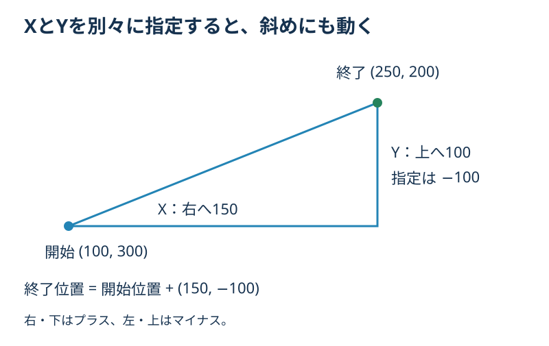
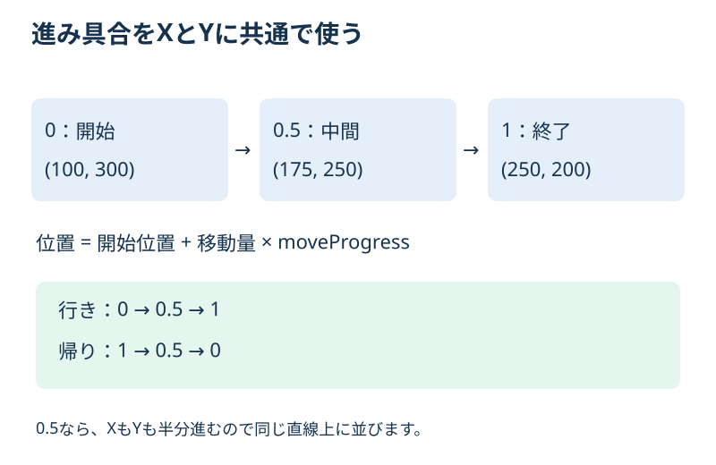
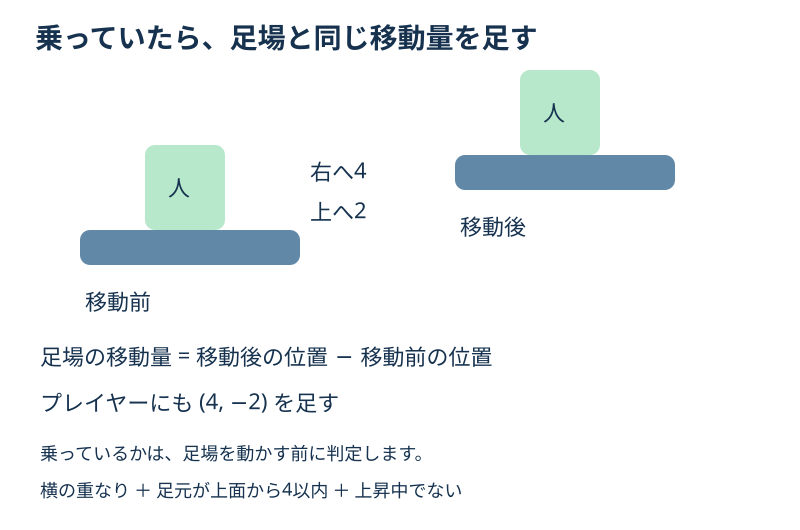

# **10_左右・上下・斜めに動く足場を作る**

## **この単元でやること**

1. X方向とY方向の移動量を別々に設定する
2. 開始位置と終了位置の間を、直線で往復する
3. 足場に乗っているプレイヤーを同じ距離だけ運ぶ

左右・上下を `movetype` で切り替える方式から、`moveDistanceX` と `moveDistanceY` を指定する方式に変更します。どちらも0なら停止、片方だけ指定すれば左右または上下、両方指定すれば斜めに動きます。

この教材は現在の `StepData` と `step` クラスに合わせた置き換え手順です。第11回以降のコードを削除する必要はありません。図は仕組みの説明用です。

## **1. 移動量で終了位置を決める**

`pos_x`・`pos_y` を開始位置にします。そこへX・Yの移動量を足した場所が終了位置です。「距離」という名前ですが、この2つは向きも含むのでマイナスも使えます。



| moveDistanceX | moveDistanceY | 行きの方向 |
| --- | --- | --- |
| 200 | 0 | 右 |
| -200 | 0 | 左 |
| 0 | 200 | 下 |
| 0 | -200 | 上 |
| 150 | -100 | 右上 |
| -150 | 100 | 左下 |
| 0 | 0 | 停止 |

画面のy座標は下ほど増えます。上へ200動かすなら、Yに `-200` を指定します。終了位置に着いたら、同じ道を通って開始位置へ戻ります。

## **2. StepDataを変更する**

**【setting.dart】`StepData` 内のフィールドを置き換える**

以前の `moveDistance`・`movetype` と既存の `moveSpeed` の宣言を、次の3行に置き換えます。`moveSpeed` を重複して宣言しないでください。

```dart
final double moveDistanceX;
final double moveDistanceY;
final double moveSpeed;
```

**【setting.dart】コンストラクターの対応する引数を置き換える**

```dart
this.moveDistanceX = 0,
this.moveDistanceY = 0,
this.moveSpeed = 100,
```

ほかの引数は残します。既存の `start_pos_x`・`end_pos_x` などもこの回では削除しません。今回の往復移動の計算には、それらではなく `pos_x`・`pos_y` と新しい移動量を使います。

### **足場ごとの設定例**

**【setting.dart】`steplist` 内の各 `StepData(...)`**

古い `moveDistance:` と `movetype:` を削除し、次のように指定します。サイズ・色・位置などの既存設定はそのままです。

```dart
// 1つ目の足場：右上へ進んで戻る
moveDistanceX: 150,
moveDistanceY: -100,
moveSpeed: 80,
```

```dart
// 2つ目の足場：真上へ200進んで戻る
moveDistanceX: 0,
moveDistanceY: -200,
moveSpeed: 80,
```

すべての `StepData(...)` について古い引数を取り除きます。残っていると、存在しない引数を指定したエラーになります。今回は `moveDistansY` ではなく、綴りを **`moveDistanceY`** に統一します。

## **3. 進み具合を保存する**

**【object.dart】`step` クラス内の既存の `moveDirection` の宣言を置き換える**

```dart
double moveProgress = 0; // 0＝開始位置、1＝終了位置
int moveDirection = 1;   // 1＝行き、-1＝帰り
```

`moveProgress` は移動ルートのどこまで進んだかを表します。更新のたびに続きから動くため、`update()` の中ではなくクラス内に置きます。



`moveDirection` は「行きか帰りか」です。右か左かを直接表す値ではありません。XやYがマイナスでも、行きは `1` で始めます。

**【object.dart】`step.onLoad()` の配置は確認のみ**

次の既存設定はそのまま使います。

```dart
position = Vector2(data.pos_x, data.pos_y);
size = Vector2(data.size_x, data.size_y);
anchor = Anchor.topLeft;
```

## **4. updateを置き換える**

**【object.dart】`step` クラスの `update(double dt)` 全体を置き換える**

既存のimportで使っている `Vector2` を利用します。`onLoad()` や `render()`、ほかのクラスは残してください。

```dart
@override
void update(double dt) {
  super.update(dt);

  final moveOffset = Vector2(
    data.moveDistanceX,
    data.moveDistanceY,
  );
  final totalDistance = moveOffset.length;

  if (totalDistance == 0 || data.moveSpeed <= 0) {
    return;
  }

  final player = gameRef.player;

  // Player は Anchor.center
  final playerLeft = player.position.x - player.size.x / 2;
  final playerRight = player.position.x + player.size.x / 2;
  final playerBottom = player.position.y + player.size.y / 2;

  // step は Anchor.topLeft
  final stepLeft = position.x;
  final stepRight = position.x + size.x;
  final stepTop = position.y;

  // 足場が動く前に、乗っているかを調べる
  final overlapsX = playerRight > stepLeft && playerLeft < stepRight;
  final isOnTop = (playerBottom - stepTop).abs() <= 4;
  final isRiding = overlapsX && isOnTop && player.velocity.y >= 0;

  // clone() で移動前の座標をコピーする
  final previousPosition = position.clone();

  // 速度を0〜1の進み具合に変換する
  moveProgress +=
      data.moveSpeed * dt / totalDistance * moveDirection;

  // 端を越えた分を折り返す
  while (moveProgress > 1 || moveProgress < 0) {
    if (moveProgress > 1) {
      moveProgress = 2 - moveProgress;
      moveDirection = -1;
    } else if (moveProgress < 0) {
      moveProgress = -moveProgress;
      moveDirection = 1;
    }
  }

  // 開始位置 + 移動量 × 進み具合
  position.setValues(
    data.pos_x + data.moveDistanceX * moveProgress,
    data.pos_y + data.moveDistanceY * moveProgress,
  );

  final moved = position - previousPosition;
  if (isRiding) {
    player.position += moved;
  }
}
```

## **5. 移動の計算を読み解く**

### **斜めの距離も含めて速度をそろえる**

`moveOffset.length` は、開始から終了までの直線距離を求めます。例えばXが300、Yが400なら、直線距離は500です。

`moveSpeed` は、その直線に沿って1秒間に進む距離です。XとYへそれぞれ同じ速度を足す方式ではないので、斜めだけ速くなることを避けられます。

`moveSpeed * dt` は今回進む距離、それを `totalDistance` で割ると「ルート全体の何割進むか」になります。距離200・速度100・経過時間0.02秒なら、2進むので、進み具合は2÷200＝0.01増えます。

**移動量がマイナスでも、`length` は正の距離になります。** 以前の `moveDistance <= 0` で止める判定は残しません。XとYが両方0の場合だけ距離0として止まります。速度は正の値を指定してください。

### **端を越えた分は折り返す**

進み具合が `1.02` になったら、終了位置を0.02越えています。`2 - 1.02 = 0.98` にして帰りへ切り替えます。

帰りに `-0.02` になったら、`0.02` に戻して行きへ切り替えます。`while` は、1回の更新で何度も端を越えた場合にも繰り返し折り返すためです。通常は小さな更新幅で動きます。

## **6. 足場と一緒にプレイヤーを運ぶ**



乗っているかは、移動前の状態で次の3つを調べます。

| 判定 | 意味 |
| --- | --- |
| `overlapsX` | プレイヤーと足場が横方向に重なる |
| `isOnTop` | 足元と足場の上面の差が4以内 |
| `player.velocity.y >= 0` | ジャンプで上昇していない |

`abs()` は差の符号を外して大きさを調べます。「4」は計算のずれを許す幅で、4マスではありません。

`previousPosition = position.clone()` で、移動前の座標をコピーします。`clone()` を付けず `position` をそのまま入れると、同じ座標オブジェクトを参照するため、移動前の値を保存できません。

足場を動かした後、`position - previousPosition` で実際の移動量を求めます。その同じ量をプレイヤーへ足すことで、左右・上下・斜めのどの方向にも運べます。

この処理は「すでに乗っているプレイヤーを運ぶ」部分です。着地させる処理は既存のプレイヤー側の衝突判定を使います。下降中に離れる、端で押し戻されるなどが起きる場合は、プレイヤー側の重力・地面判定・更新順も確認します。この教材だけで既存の衝突処理全体を置き換えるわけではありません。

## **確認すること**

足場があるステージを再起動して確認します。ホットリロードでは進み具合が残るため、設定を変えたら再起動してください。

- Xが200・Yが0で、左右に往復する。
- Xが0・Yが-200で、開始位置から上へ進んで戻る。
- Xが150・Yが-100で、右上へ直線で進んで戻る。
- XとYが両方0なら、その場に止まる。
- 足場に乗ったプレイヤーが、行きも帰りも運ばれる。
- 足場からジャンプして上昇中は、運ばれ続けない。

終了位置が地面・ほかの足場・画面外へ入り込まないよう、ステージに合った開始位置と移動量を選びます。

## **練習と確認問題**

1. 左上へ動かすには、XとYをどんな符号にしますか？
2. 開始(100, 300)、移動量(150, -100)で、進み具合が0.5なら位置はいくつですか？
3. `moveDirection = 1` は、必ず右へ動くという意味ですか？

<details>
<summary>答えと解説</summary>

1. 両方マイナスです。左はxを減らし、上はyを減らします。
2. (175, 250)です。開始位置に移動量の半分(75, -50)を足します。
3. いいえ。開始から終了へ向かう「行き」という意味です。実際の方向はX・Yの移動量で決まります。

</details>

## **今日の課題**

1つの足場を「左右」「上下」「斜め」に順番に設定し、再起動して確認しましょう。斜めの設定では乗ったまま往復できるかも確かめます。X・Yの符号と動く方向について分かったことをメモしてください。

## **次回への案内**

第11回ではダンジョンの入口を作ります。この回で編集する場合の退避対象は `setting.dart` と `object.dart` です。実行用の名前は残し、コピーを別名で保存してください。

図解は `img/10_xy.svg`、`img/10_progress.svg`、`img/10_carry.svg` を同じ階層の `img` フォルダに置いて参照します。
