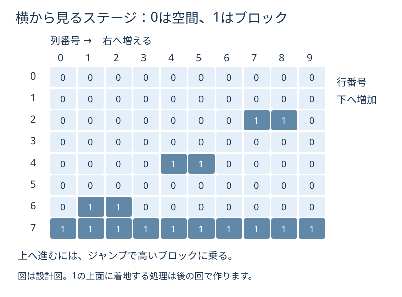
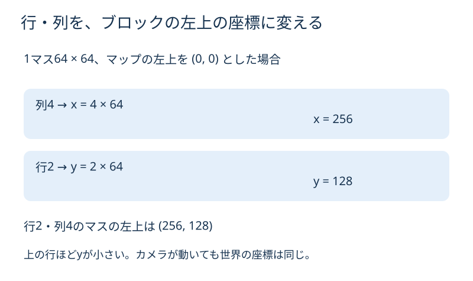

# **12_横から見るダンジョンを配列で設計する**

## **この単元でやること**

1. `0＝空間、1＝ブロック` と決める
2. 横から見た地面と足場を二次元配列で作る
3. `case 2` から配列の内容を読み取る

## **1. 数値の意味を決める**

上から見るマップでは0を床にしていましたが、今回は**0は空間**です。空間では重力で落下し、下にブロックがあれば、その上に着地する設計です。

| 数値 | 名前 | 意味 | 今後追加する判定 |
| --- | --- | --- | --- |
| 0 | dungeonEmpty | 空間 | ブロックを作らず、通過できる |
| 1 | dungeonBlock | 地面・壁・足場 | 横からは通れず、上面に乗れる |

背景の色や装飾は別に描きます。`1` と書くだけで自動的に当たり判定が付くわけではありません。描画と衝突処理を後の回で結び付けます。出口の番号は今回は追加しません。

**【lib/dungeon.dart】第11回のコードへ新規追加**

旧方式の同名ファイルがある場合は、退避したうえで今回の内容に置き換えます。この回のファイルはデータだけなので、importは不要です。

```dart
const int dungeonEmpty = 0;
const int dungeonBlock = 1;

// ゲーム世界での1マスの大きさ
const double dungeonTileSize = 64;
```

`int` は整数、`const` は変更しない値です。タイル画像が32×32でも、表示は64×64にできます。画像の切り取りは次の描画の回で扱います。

## **2. 地面と高い足場を配列で作る**

**【dungeon.dart】先ほどの定義の後に追加**

```dart
const List<List<int>> dungeonMap = [
  [0, 0, 0, 0, 0, 0, 0, 0, 0, 0],
  [0, 0, 0, 0, 0, 0, 0, 0, 0, 0],
  [0, 0, 0, 0, 0, 0, 0, 1, 1, 0],
  [0, 0, 0, 0, 0, 0, 0, 0, 0, 0],
  [0, 0, 0, 0, 1, 1, 0, 0, 0, 0],
  [0, 0, 0, 0, 0, 0, 0, 0, 0, 0],
  [0, 1, 1, 0, 0, 0, 0, 0, 0, 0],
  [1, 1, 1, 1, 1, 1, 1, 1, 1, 1],
];
```

`List<int>` は整数を横に並べた1行です。それを上から順に並べたものが `List<List<int>>` です。外側の角括弧がマップ全体、内側の角括弧が1行を表します。



- 最下段の行7は、すべて1にして地面を作ります。
- 行6・列1〜2に低い足場を置きます。
- 行4・列4〜5、行2・列7〜8に、より高い足場を置きます。
- その他は0にして、移動やジャンプのための空間を空けます。

これは配置の練習用データです。実際に届く高さ・横幅かは、描画と着地判定ができた後にジャンプ力や移動速度に合わせて調整します。プレイヤーを表す番号は配列に入れません。

## **3. 行と列を読み取る**

行も列も0から数えます。配列は `dungeonMap[行][列]` の順です。

```dart
// 説明用。ファイルへ追加する必要はありません。
dungeonMap[7][0] // 1：最下段の地面
dungeonMap[6][1] // 1：低い足場
dungeonMap[5][1] // 0：低い足場の上の空間
```

このマップは縦8行・横10列です。使える番号は行0〜7、列0〜9です。例えば `dungeonMap[8][0]` は存在しない行を読むためエラーになります。

## **4. 行・列と座標の関係を知る**



マップの左上を `(0, 0)` に置くなら、ブロックの左上は `x = 列 × 64`、`y = 行 × 64` で求めます。10列×8行なので、全体の大きさは横640・縦512です。

画面では、下へ進むほどyが増えます。高い場所の足場ほど行番号が小さくなります。今後はこの世界の位置を基準に、カメラが見る範囲を上下にも動かします。カメラ追従はまだこの回では変更しません。

## **5. case 2からデータを確認する**

**【game.dart】importの並びへ追加**

```dart
import 'dungeon.dart';
```

**【game.dart】`objectRemove()` の `case 2` を置き換える**

```dart
      case 2:
        debugPrint('ダンジョン：${dungeonMap.length}行 × ${dungeonMap[0].length}列');
        debugPrint('地面のマス：${dungeonMap[7][0]}');
        debugPrint('空間のマス：${dungeonMap[5][1]}');
        break;
```

`length` は個数です。マップには8行、先頭行には10個の数値が入っています。`debugPrint()` は開発用コンソールに結果を出し、`${...}` は計算結果を文字列へ埋め込みます。

`case 2` はダンジョンの準備時に実行されます。今回はデータを読むだけです。第11回の共通の地面、左右移動、ジャンプ、重力は残してください。

## **確認すること**

アプリを再起動し、ステージ1の扉から入り直します。コンソールに次の内容が出ることを確認します。

```text
ダンジョン：8行 × 10列
地面のマス：1
空間のマス：0
```

画面は第11回と同じ暗い背景と地面のままです。左右移動とジャンプができることも確認します。配列に書いた高い足場は、まだ表示されなくて正常です。

## **練習と確認問題**

1. 今回の0は、床と空間のどちらですか？
2. 行番号が小さい足場ほど、高い位置ですか、低い位置ですか？
3. 行4・列5のマスの左上はどこですか？（1マス64、原点0・0）

<details>
<summary>答えと解説</summary>

1. 空間です。足場は1で表します。
2. 高い位置です。画面では下ほどy座標が増えるためです。
3. `(320, 256)` です。xは5×64、yは4×64で求めます。

</details>

## **今日の課題**

行4の足場を1マス横へ広げるように、0を1へ変更してみましょう。各行の数値は10個のままにします。図と配列を見比べ、どの行・列を変更したかをメモしてください。表示の確認は次の回で行います。

## **次回への案内**

次は配列を読んでブロックを表示します。その後、1のブロックに横からぶつかる判定・上面へ着地する判定を付け、上方向にも追従するカメラへ進めます。各回で止めて、退避してから次へ進みます。

今回の教材を実装した場合の退避対象は `dungeon.dart` と `game.dart` です。実行用の名前は残し、コピーを別名で保存してください。旧方式の第13〜15回は新方針に対応するまで適用しません。
