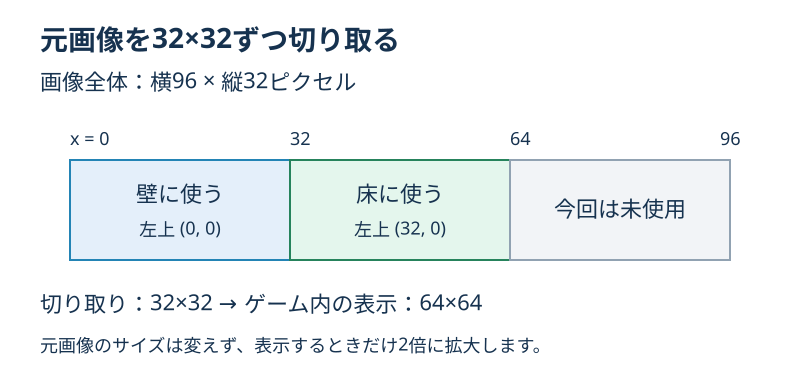
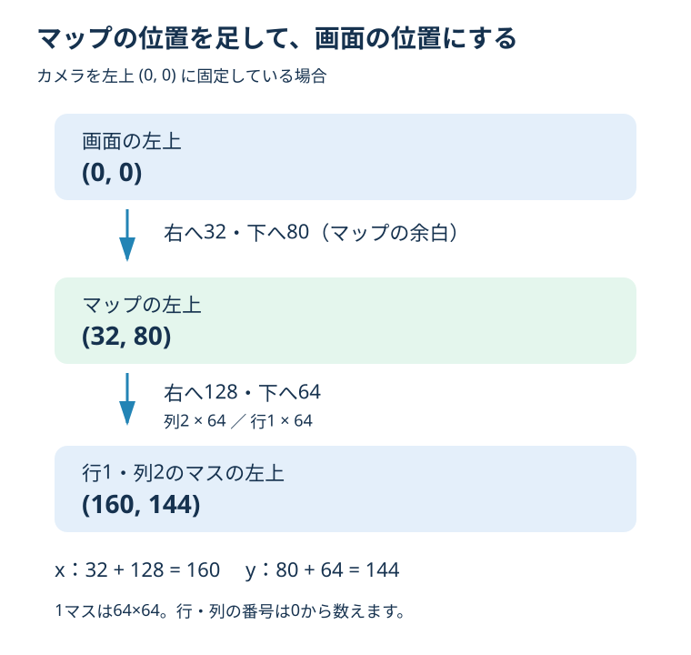

# **13_配列からブロックを表示する**

## **この単元でやること**

1. タイルセット画像から床と壁を切り取る
2. 二次元配列を読み、ブロックを並べる
3. ダンジョンに入ったら迷路を表示する

前回の配列はダンジョンの設計図でした。今回は、数値を画像に置き換えて画面に並べます。上から見た迷路の背景を作る回です。プレイヤーの配置・四方向移動・壁との当たり判定は、まだ追加しません。

## **1. 画像を準備する**

**【assets/images/battle_tileset.png】画像を追加**

提供された `battle_tileset.png` をこの場所にコピーします。今回は反映済みです。元の画像は変更しません。

画像全体は横96・縦32ピクセルです。32×32ずつ切り取ると、横に3種類の模様があります。今回は左の模様を壁、中央の模様を床として使います。

| 用途 | 切り取りの左上（x, y） | 切り取りサイズ |
| --- | --- | --- |
| 壁 | (0, 0) | 32×32 |
| 床 | (32, 0) | 32×32 |



`pubspec.yaml` にはすでに `assets/images/` が登録されています。そのため今回は設定の追記は不要です。新しい画像を追加したので、確認時はアプリを停止して起動し直してください。

## **2. 配列の位置を画面の位置に変える**

プレイヤーの大きさ64に合わせ、1マスの表示サイズを64×64にします。元画像は32×32で切り取り、表示するときだけ縦横2倍に拡大します。画像ファイル自体の変更は不要です。列が増えると右へ、行が増えると下へ進みます。

```text
マップ内のx座標 = 列番号 × 64
マップ内のy座標 = 行番号 × 64
```

例えば行1・列2なら、マップ内の位置は `(128, 64)` です。

今回はマップ全体の左上を `(32, 80)` に置きます。上部に表示用の余白を取るためです。カメラを左上で固定するので、行1・列2の画面上の左上は `(160, 144)` になります。



7列×6行のマップ全体は、横448・縦384です。

## **3. ブロックを並べるクラスを作る**

**【dungeon.dart】先頭にimportを追加**

```dart
import 'package:flame/components.dart';
import 'package:flutter/material.dart';
import 'game.dart';
```

**【dungeon.dart】前回の配列と開始位置の定義は残し、末尾に追加**

```dart
// 画像から切り取るサイズと、ゲーム内で表示するサイズ。
const double dungeonSourceSize = 32;
const double dungeonTileSize = 64;

// マップの左上。画面上部に表示用の余白を取る。
const double dungeonMapLeft = 32;
const double dungeonMapTop = 80;

class DungeonMapComponent extends PositionComponent with HasGameRef<MainGame> {
  @override
  Future<void> onLoad() async {
    await super.onLoad();
    position = Vector2(dungeonMapLeft, dungeonMapTop);
    size = Vector2(
      dungeonMap[0].length * dungeonTileSize,
      dungeonMap.length * dungeonTileSize,
    );
    priority = -1;

    final wallSprite = await gameRef.loadSprite(
      'battle_tileset.png',
      srcPosition: Vector2(0, 0),
      srcSize: Vector2.all(dungeonSourceSize),
    );
    final floorSprite = await gameRef.loadSprite(
      'battle_tileset.png',
      srcPosition: Vector2(32, 0),
      srcSize: Vector2.all(dungeonSourceSize),
    );

    for (int row = 0; row < dungeonMap.length; row++) {
      for (int column = 0; column < dungeonMap[row].length; column++) {
        final tile = dungeonMap[row][column];
        final tilePosition = Vector2(
          column * dungeonTileSize,
          row * dungeonTileSize,
        );

        await add(SpriteComponent(
          sprite: tile == dungeonWall ? wallSprite : floorSprite,
          position: tilePosition,
          size: Vector2.all(dungeonTileSize),
          paint: Paint()..filterQuality = FilterQuality.none,
        ));

        if (tile == dungeonExit) {
          await add(RectangleComponent(
            position: tilePosition + Vector2.all(8),
            size: Vector2.all(dungeonTileSize - 16),
            paint: Paint()..color = const Color(0xFF4ADE80),
            priority: 1,
          ));
        }
      }
    }
  }
}

```

`PositionComponent` は、位置やサイズを持つ部品です。今回はマップ全体の親として使い、その中に各マスの `SpriteComponent` を追加します。子の位置は親の左上を基準にするため、各マスへ余白の `(32, 80)` を足す必要はありません。

`onLoad()` は部品の読み込み時に実行されます。ここで画像を読み込み、マスを作ります。`await` は読み込みや追加処理を待つために使います。

`srcPosition` は元画像のどこから切り取るか、`srcSize` は切り取る大きさです。一方、`SpriteComponent` の `position` と `size` は、ゲーム内でどこに、どの大きさで表示するかを決めます。

### **二重のfor文の読み方**

外側の `for` が行を選び、内側の `for` がその行の列を左から順に選びます。1行の終わりまで進んだら、次の行へ移ります。

`tile == dungeonWall ? wallSprite : floorSprite` は「壁なら壁画像、それ以外なら床画像」という意味です。出口も床を描き、その上に緑の四角を重ねます。

緑の目印は上下左右に8ずつ余白を取り、48×48（64 − 8 − 8）で描きます。まだ出口へ移動しても場面は切り替わりません。

### **重なる順番**

`priority` は描画の順番です。同じ親の中では、小さい値が先に描かれます。背景は `-2`、マップは `-1` にして、既存のプレイヤーより奥へ置きます。出口の目印はマップ内で `1` にするため、マスの画像より手前になります。

## **4. case 2 でマップを追加する**

**【game.dart】`objectRemove()` の `case 2` を置き換える**

前回の確認用 `debugPrint()` を、マップの追加へ置き換えます。`import 'dungeon.dart';` は前回追加済みです。

```dart
      case 2:
        //⭐️ 配列から床・壁・出口を表示する
        await world.add(DungeonMapComponent());
        break;
```

**【game.dart】`objectRemove()` の背景と地面を追加する部分を置き換える**

`await CameraRemove();` の直後から、地面を追加する部分までを次のようにします。後ろのプレイヤー追加処理は残します。

```dart
    CameraBackScreen backscreen = CameraBackScreen()..priority = -2;
    await world.add(backscreen);

    //⭐️ ダンジョンには横スクロール用の地面を置かない
    if (currentStage != 2) {
      Cameraground ground = Cameraground();
      await world.add(ground);
    }
```

`..priority = -2` は、作った背景の描画順をその場で設定する書き方です。ダンジョンでは配列の床を使うので、横スクロール用の茶色い地面は追加しません。ほかのステージにはこれまでどおり追加します。

## **5. 表示確認用にカメラを固定する**

今のカメラは横スクロール用です。そのままだとプレイヤーを追いかけて、今回の小さなマップが画面外へずれることがあります。ダンジョンだけ、左上を固定して表示します。上下左右に追従するカメラは第18回で作ります。

**【game.dart】`CameraRemove()` の先頭に追加**

```dart
    //⭐️ 今回はマップの表示を確認するためカメラを固定する
    if (currentStage == 2) {
      cameraComponent.viewfinder.anchor = Anchor.topLeft;
      cameraComponent.viewfinder.position = Vector2.zero();
      cameraComponent.viewfinder.zoom = 1.0;
      return;
    }
```

`Anchor.topLeft` で左上を基準にし、カメラの位置を `(0, 0)` にします。`return` により、このときだけ後ろの横スクロール用設定を実行しません。

**【game.dart】`update(double dt)` の `super.update(dt);` の直後に追加**

```dart
    //⭐️ ダンジョンでは横スクロール用の追従処理を実行しない
    if (currentStage == 2) return;
```

既存のカメラ追従処理が、固定したカメラの位置を毎フレーム上書きすることを防ぎます。`super.update(dt)` は実行されるので、プレイヤーなどの部品の更新まで停止するわけではありません。

## **確認すること**

アプリを再起動し、ステージ1の扉に触れてダンジョンへ入ります。

- 暗い背景の左上寄りに、7列×6行の迷路が表示される。
- 配列の `1` が壁の模様、`0` が床の模様になる。
- 行1・列5の出口に緑の四角が出る。
- ダンジョンでは茶色い横スクロール用の地面が表示されない。
- ダンジョン内では、プレイヤーが動いてもマップの表示位置が変わらない。

画面内に全体を見るには、少なくとも横480・縦464の表示範囲が必要です。これは左の余白32と上の余白80を含む大きさです。今回は端末サイズに合わせた自動調整は扱いません。

プレイヤーは前回の位置・移動方式のままです。迷路の開始位置にはまだ置かれません。また、壁画像を表示するだけでは通行を止められません。配置は次回、移動は第15回、壁判定は第16回で作ります。

画像が出ないときは、ファイルの場所と名前を確認してアプリを停止・再起動してください。

## **練習と確認問題**

1. 行2・列3の、マップ内での左上の位置はどこですか？
2. `srcPosition` と `position` は何が違いますか？
3. 出口で床を描いた後に緑の四角を描くのはなぜですか？

<details>
<summary>答えと解説</summary>

1. `(192, 128)` です。xは列3×64、yは行2×64で求めます。
2. `srcPosition` は画像内の切り取り開始位置、`position` は部品を配置する位置です。
3. 出口も床のあるマスとして表示し、その上へ出口の目印を重ねるためです。

</details>

## **今日の課題**

配列の床を1マスだけ壁へ変更し、再起動して画像も変わることを確認しましょう。開始位置から出口までの道は残してください。最後に、数値と画像の対応について分かったことをメモしましょう。

## **次回への案内**

次は **14「プレイヤーを配置する」** です。マップの行・列から位置を求めて、開始位置の床へプレイヤーを置きます。

**今回はここで終了です。** 退避対象は `lib/dungeon.dart` と `lib/game.dart` です。実行用のファイル名は残し、コピーに別名を付けて保存してください。追加した `assets/images/battle_tileset.png` もプロジェクト内に残します。
