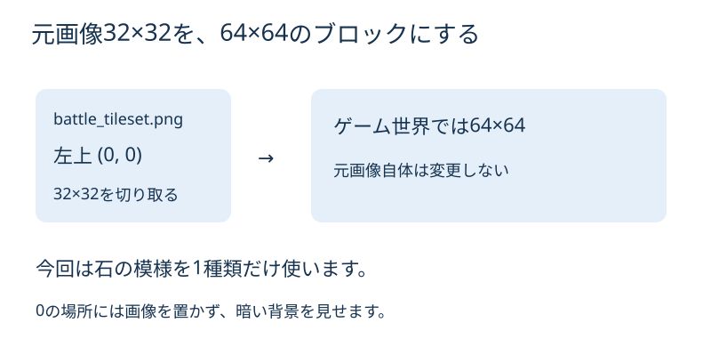
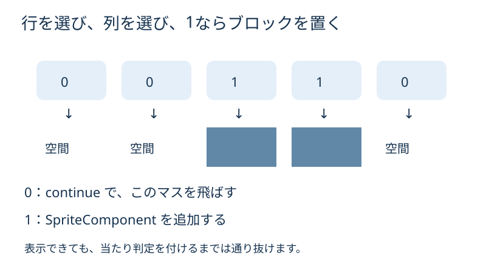
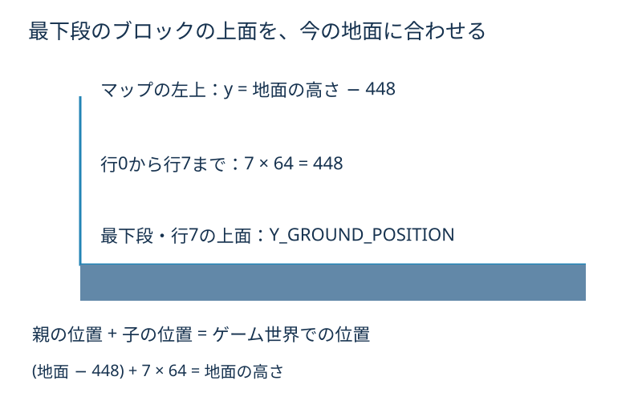

# **13_横から見るダンジョンのブロックを表示する**

## **この単元でやること**

1. 32×32の石の画像を、64×64で表示する
2. 配列の1の場所だけブロックを置く
3. 最下段のブロックを、今の地面の高さに合わせる

第12回の `0＝空間、1＝ブロック` の設計図を、画面に表示します。横から見る視点で、左右移動・ジャンプ・重力はそのまま使います。

**今回は表示だけです。** ブロックへ乗る・横からぶつかる判定は次回に作ります。上下カメラもまだ変更しません。

## **始める前に**

新方針の第12回まで実装したコードを使います。`dungeonMap` は8行10列、`dungeonBlock = 1`、`dungeonTileSize = 64` です。古い上から見る第13〜15回を適用したコードへ、そのまま追記しないでください。

現在の作業フォルダに旧方式が残っている場合は、第12回に記載したとおり、第11回の退避ファイルから新しい第12回を実装した組み合わせを用意します。重力を止める分岐・四方向移動・カメラ固定・マス中央へのプレイヤー配置は使いません。

## **1. 画像を準備する**

**【assets/images/battle_tileset.png】**

提供された画像をこの場所に置きます。すでに同じ名前の画像がある場合は、そのまま使えます。現在のプロジェクトの `pubspec.yaml` には `assets/images/` が登録されています。



画像全体は96×32です。そのうち左端の32×32を使います。今回は壁用・床用を分けず、1の場所に同じ石のブロックを並べます。画像を追加した後はアプリを停止して再起動してください。

## **2. マップを表示するクラスを作る**

**【dungeon.dart】先頭にimportを追加**

```dart
import 'package:flame/components.dart';
import 'package:flutter/material.dart';
import 'game.dart';
import 'setting.dart';
```

`setting.dart` から既存の地面の高さ `Y_GROUND_POSITION` を使います。

**【dungeon.dart】第12回の定数と配列を残し、その後に追加**

```dart
class DungeonMapComponent extends PositionComponent with HasGameRef<MainGame> {
  @override
  Future<void> onLoad() async {
    await super.onLoad();

    // 最下段のブロックの上面を、既存の地面に合わせる
    position = Vector2(
      0,
      Y_GROUND_POSITION - (dungeonMap.length - 1) * dungeonTileSize,
    );
    size = Vector2(
      dungeonMap[0].length * dungeonTileSize,
      dungeonMap.length * dungeonTileSize,
    );
    priority = 1;

    final blockSprite = await gameRef.loadSprite(
      'battle_tileset.png',
      srcPosition: Vector2.zero(),
      srcSize: Vector2.all(32),
    );

    for (int row = 0; row < dungeonMap.length; row++) {
      for (int column = 0; column < dungeonMap[row].length; column++) {
        if (dungeonMap[row][column] != dungeonBlock) {
          continue;
        }

        await add(SpriteComponent(
          sprite: blockSprite,
          position: Vector2(
            column * dungeonTileSize,
            row * dungeonTileSize,
          ),
          size: Vector2.all(dungeonTileSize),
          anchor: Anchor.topLeft,
          paint: Paint()..filterQuality = FilterQuality.none,
        ));
      }
    }
  }
}
```

`DungeonMapComponent` はマップ全体をまとめる親です。その中に、石の画像を表示する `SpriteComponent` をマスごとに追加します。

`onLoad()` で画像を読み込み、部品を作ります。`await` は読み込みや追加を待つために使います。1枚の `blockSprite` を、すべてのマスで再利用します。

## **3. 二重のfor文で配列を読む**



外側の `for` で行を上から順に選び、内側の `for` でその行の列を左から順に選びます。

```dart
if (dungeonMap[row][column] != dungeonBlock) {
  continue;
}
```

`!=` は「等しくない」です。値が1でないマスは `continue` で飛ばし、次の列へ進みます。マップ全体の処理を終了するわけではありません。

0には何も追加しないため、後ろの暗い背景が見えます。1には画像を追加しますが、まだ `RectangleHitbox` や衝突処理は付けません。

## **4. ブロックの位置と描画順を決める**

マップ内の左上の位置は、xが列×64、yが行×64です。第12回で学んだ計算をそのまま使います。

```dart
position: Vector2(
  column * dungeonTileSize,
  row * dungeonTileSize,
),
```

`srcPosition`・`srcSize` は元画像の切り取り位置と大きさ、`SpriteComponent` の `position`・`size` はゲーム内での位置と大きさです。`Anchor.topLeft` により、指定位置が各ブロックの左上になります。

`FilterQuality.none` は拡大時の画像をぼかさない設定です。

マップ全体の `priority = 1` は、既存の背景と地面（通常0）より手前へ描くためです。プレイヤーは既存の `priority = 10` なので、ブロックより手前に表示されます。この順番は見た目の順番で、当たり判定の有無を決める設定ではありません。

## **5. 最下段を今の地面へ合わせる**

第12回では、マップの左上を原点とした座標を学びました。今回は実際の画面へ組み込むために、マップ全体を縦方向へずらします。



8行のマップの最下段は行7です。その上面はマップ内で `7 × 64 = 448`。そこで親のy座標を次のようにします。

```dart
Y_GROUND_POSITION - (dungeonMap.length - 1) * dungeonTileSize
```

最下段の上面は「地面−448＋448」となり、既存の地面の高さと一致します。最下段ブロックの**下辺ではなく上面**を合わせている点がポイントです。

子の座標へ地面の高さをもう一度足す必要はありません。親の位置に、子のマップ内の位置が足されて表示されます。

## **6. case 2で追加する**

**【game.dart】`objectRemove()` の `case 2` を置き換える**

```dart
      case 2:
        await world.add(DungeonMapComponent());
        break;
```

第12回の確認用 `debugPrint()` をマップの追加へ置き換えます。`import 'dungeon.dart';` は追加済みなので、そのまま使います。

**既存の地面は、この回では残します。** `Cameraground` の追加と、プレイヤー側の既存の地面判定を使い続けます。ブロックの上に見える位置で立っていても、今回はまだ従来の地面判定で支えられています。

ダンジョン専用のカメラ固定や重力を止める分岐は追加しません。背景・プレイヤー・カメラの処理は、新方針の第12回までのものを使います。

## **確認すること**

アプリを再起動し、扉からダンジョンへ入ります。

- 最下段に10個の石のブロックが横に並ぶ。
- その上に2個ずつ、3段の足場が表示される。
- 0の場所にはブロックがなく、背景が見える。
- 左右移動とジャンプができ、従来の地面で着地する。
- 空中のブロックはまだ通り抜ける。これは今回の段階では正常。

第12回の配列を変更していなければ、表示するブロックは合計16個です。画面が狭ければ一度に全部は見えません。横へ歩いて確認できますが、上下追従はまだないので高い部分が画面外になる場合があります。確認時は十分な高さのウィンドウを使ってください。

このマップの最下段は幅640だけです。従来の地面判定はそれより外でも続いています。配列の地形との整合やマップ端の扱いは、当たり判定の回で整理します。

## **練習と確認問題**

1. 0の場所に画像を追加しないのはなぜですか？
2. 元画像の切り取りは32なのに、表示を64にできるのはなぜですか？
3. 8行の最下段の上面は、マップ内のy座標でいくつですか？

<details>
<summary>答えと解説</summary>

1. 0は空間だからです。後ろの背景を見せます。
2. 切り取りサイズと、ゲーム内での表示サイズを別々に指定しているからです。
3. 行番号7×64＝448です。番号は0から数えます。

</details>

## **今日の課題**

行4の足場の右隣の0を1に変え、再起動して足場が1個増えることを確認しましょう。次に0へ戻すと画像が消えることも確認します。どの行・列を変えたかをメモしてください。

## **次回への案内**

次は**1のブロックの当たり判定**を作ります。横からぶつかったら止まり、上から落ちてきたら上面へ着地できるようにします。その後、高い場所を追う上下カメラへ進めます。

**今回はここで終了です。** 実装した場合の退避対象は `dungeon.dart` と `game.dart` です。実行用の名前は残し、コピーを別名で保存してください。旧方式の第14〜15回は、新方針に更新されるまで適用しません。
