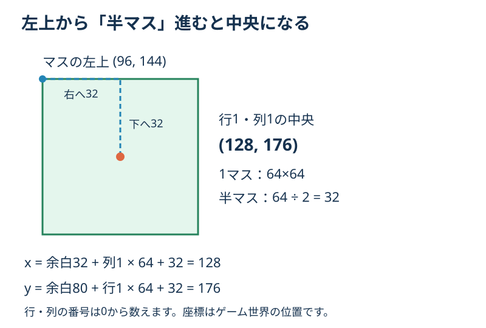
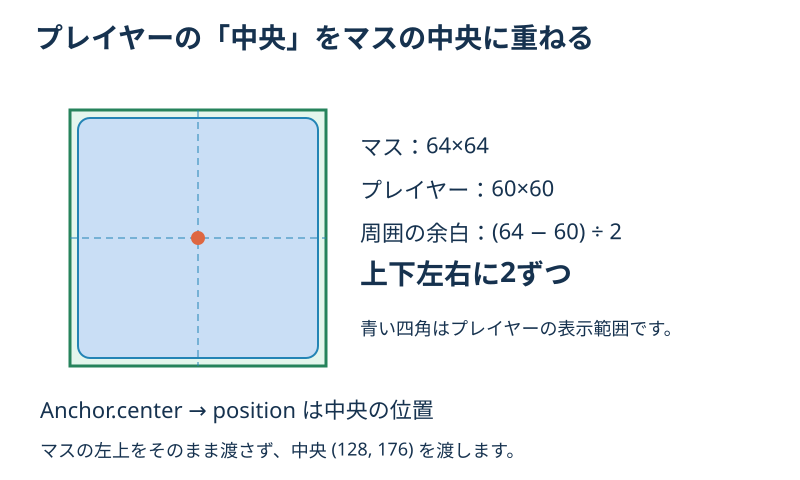
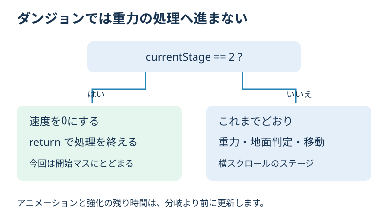

# **14_プレイヤーをダンジョンに配置する**

## **この単元でやること**

1. 開始マスの中央の座標を求める
2. その位置へプレイヤーを置く
3. ダンジョンでは重力と横スクロール用の操作を止める

前回は64×64のブロックを並べました。今回は、その床の上にプレイヤーを置きます。完成すると、扉から入ったプレイヤーが開始マスにとどまります。四方向への移動は次回です。

現在の `setting.dart` では `PLAYER_SIZE_X` と `PLAYER_SIZE_Y` はどちらも `60.0` です。これまでの説明ではプレイヤーも64としていましたが、実際は60×60でした。この回ではその設定を変えず、64×64のマスの中央へ置きます。

## **1. マスの中央を求める**

開始位置は前回までと同じ、行1・列1です。行・列は0から数えるので、上から2番目・左から2番目の床になります。

前回求めたのは「マスの左上」でした。今回はそこから右と下に半マスずつ進み、「マスの中央」を求めます。



**【dungeon.dart】`dungeonMapTop` の定義の後、`DungeonMapComponent` クラスの前に追加**

```dart
// 行・列から、マスの中央のワールド座標を求める。
Vector2 dungeonTileCenter(int row, int column) {
  return Vector2(
    dungeonMapLeft + column * dungeonTileSize + dungeonTileSize / 2,
    dungeonMapTop + row * dungeonTileSize + dungeonTileSize / 2,
  );
}
```

`row` は行、`column` は列です。`Vector2` はxとyの2つの値をまとめます。`return` により、計算した位置を呼び出し元へ返します。

| 計算の部分 | 意味 |
| --- | --- |
| `dungeonMapLeft` / `dungeonMapTop` | マップ全体の左上 |
| `column * dungeonTileSize` / `row * dungeonTileSize` | マップ内でのマスの左上 |
| `dungeonTileSize / 2` | 左上から中央へ進む距離 |

ワールド座標とは、ゲーム世界の中での位置です。今はカメラを左上に固定しているので画面の位置と一致します。今後カメラが動いても、この関数で求める世界の位置は変わりません。

## **2. プレイヤーの基準位置を確認する**

**【player.dart】`onLoad()` 内を確認（この部分の変更は不要）**

```dart
size = Vector2(PLAYER_SIZE_X, PLAYER_SIZE_Y);
anchor = Anchor.center;
```

`anchor` は「部品のどこを `position` の位置に合わせるか」です。`Anchor.center` なら、プレイヤーの中央を合わせます。



プレイヤーにマスの左上の座標を渡すと、プレイヤーの中央がマスの角に来てしまいます。そこで、先ほどの関数で求めた中央 `(128, 176)` を渡します。

なお、マップのマスは `DungeonMapComponent` の子ですが、プレイヤーは `world` に直接追加されています。プレイヤーの位置には、マップ全体の余白 `(32, 80)` も含める必要があります。`dungeonTileCenter()` は、その余白まで足して返しています。

## **3. case 2 でプレイヤーを配置する**

**【game.dart】`objectRemove()` 内の `case 2` を置き換える**

```dart
      case 2:
        //⭐️ 配列から床・壁・出口を表示する
        await world.add(DungeonMapComponent());
        //⭐️ 読み込み後に、開始マスの中央へ配置する
        await player.loaded;
        player.stopMovement();
        player.velocity.setZero();
        player.position = dungeonTileCenter(
          dungeonStartRow,
          dungeonStartColumn,
        );
        player.previousY = player.position.y;
        player.isOnGround = false;
        player.isFall = false;
        break;
```

`await player.loaded` は、プレイヤーの画像や初期設定の読み込み完了を待ちます。`Player.onLoad()` にも位置の設定があるため、それが終わってからダンジョンの位置を設定します。

`stopMovement()` で停止用アニメーションにし、`velocity.setZero()` で上下左右の速度を0に戻します。これにより、扉へ入る前の移動速度を残しません。

`previousY` は直前の高さ、`isFall` は落下中かどうかを表します。場面を切り替えるので、位置に合わせてこれらも整えます。

`isOnGround` は横スクロール用の「地面に接しているか」です。ダンジョンの床に立つことを表す変数としては使わず、`false` にします。重力を止める処理は手順5で追加します。

### **入口の処理は、配置をcase 2に任せる**

**【game.dart】`enterDungeon()` の末尾を変更**

`RetryPosition = PLAYER_SIZE_X / 2;` より後を、次の内容にします。従来の `player.position = Vector2(...)` と `player.isOnGround = true;` は削除します。

```dart
    player.stopMovement();
    player.velocity.setZero();
    //⭐️ 開始位置への配置は objectRemove() の case 2 で行う

    await objectRemove(keepPlayer: true);
  }
```

`keepPlayer: true` によって、既存のプレイヤーを使い続けます。新しいプレイヤーを作り直さないので、持っている強化アイテムの個数も引き継ぎます。

## **4. 今回はダンジョンの操作を止める**

**【player.dart】`onKeyEvent()` の先頭に追加**

```dart
  bool onKeyEvent(KeyEvent event, Set<LogicalKeyboardKey> keysPressed) {
    //⭐️ 今回は配置の確認だけ。四方向移動は次回作る
    if (currentStage == 2) {
      return true;
    }

    // この後の既存のキー処理は残す
```

上のコードは関数の先頭部分です。関数全体を置き換えず、`if` の部分だけを先頭へ追加してください。

ダンジョンでは既存の左右移動・ジャンプ・射撃・アイテム使用を実行しません。キーを押しても開始マスにとどまるのが、今回の完成状態です。ステージ0・1の操作はこれまでどおりです。

## **5. ダンジョンでは重力をかけない**

位置を設定するだけでは、次の更新で重力が働き、横スクロール用の地面へ落ちてしまいます。ダンジョンでは、その処理へ進まないように分けます。



**【player.dart】`update(double dt)` の `previousY = position.y;` の直前に追加**

```dart
    //⭐️ ダンジョンでは横スクロール用の物理処理を行わない
    if (currentStage == 2) {
      velocity.setZero();
      isOnGround = false;
      isFall = false;
      return;
    }

    previousY = position.y;

    applyGravity(dt, gravity);
```

`previousY` と `applyGravity` は、元からある位置確認用の行です。二重に追加しないでください。

この位置で `return` すると、後ろにある重力・地面判定・左右の範囲制限・速度による位置更新をまとめて通らなくなります。重力だけ0にしても、既存の地面判定や移動処理が残るため、この回では処理ごと分けます。

前にある `super.update(dt)` と、強化の残り時間の更新は残します。アニメーションと強化時間は引き続き進みます。

## **確認すること**

アプリを再起動し、ステージ1の扉からダンジョンに入ります。

- プレイヤーが行1・列1の床に表示される。
- プレイヤーの中央は `(128, 176)` にある。
- 時間がたっても下へ落ちない。
- 矢印・スペース・E・Qを押しても、この回ではダンジョン内の操作は起きない。
- 床・壁・緑の出口が前回と同じように表示される。
- ダンジョンへ入る前は、左右移動やジャンプが使える。

すでにダンジョンにいる状態でホットリロードしても、配置処理が実行されるとは限りません。アプリを再起動し、扉から入り直して確認します。

## **練習と確認問題**

1. なぜ座標の計算に `dungeonTileSize / 2` を足しますか？
2. プレイヤーの `anchor` が中央なのに、マスの左上の位置を渡すとどうなりますか？
3. マップの余白は同じで、行1・列2へ置くなら中央の座標はいくつですか？

<details>
<summary>答えと解説</summary>

1. マスの左上から中央へ、半マス分進むためです。今回は64÷2＝32です。
2. プレイヤーの中央がマスの左上に重なり、狙った床からずれて表示されます。
3. `(192, 176)` です。xは32＋2×64＋32、yは80＋1×64＋32で計算します。

</details>

## **今日の課題**

`dungeonStartColumn` を一時的に `2` へ変更し、再起動してプレイヤーが右隣の床へ移ることを確認しましょう。確認できたら `1` に戻します。なぜ中央のx座標が64増えるのか、短くメモしてください。

## **次回への案内**

次は **15「上下左右に移動する」** です。今回止めたダンジョン内の操作に、四方向への移動を追加します。壁の当たり判定は第16回です。

**今回はここで終了です。** 退避対象は `lib/dungeon.dart`、`lib/game.dart`、`lib/player.dart` の3ファイルです。実行用のファイル名は残し、コピーを別名で保存してください。教材用画像は `img/14_center.svg`、`img/14_anchor.svg`、`img/14_update.svg` です。
