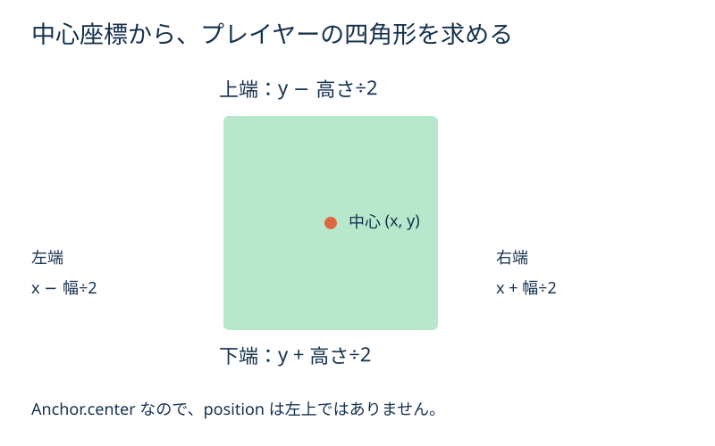
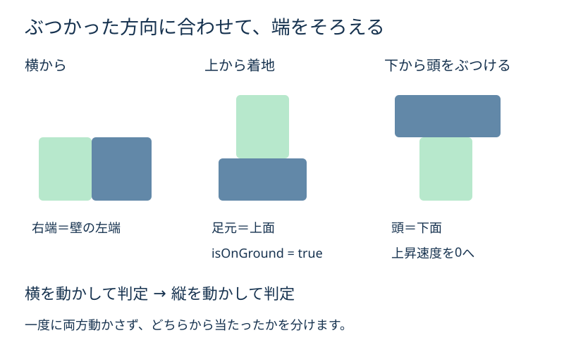
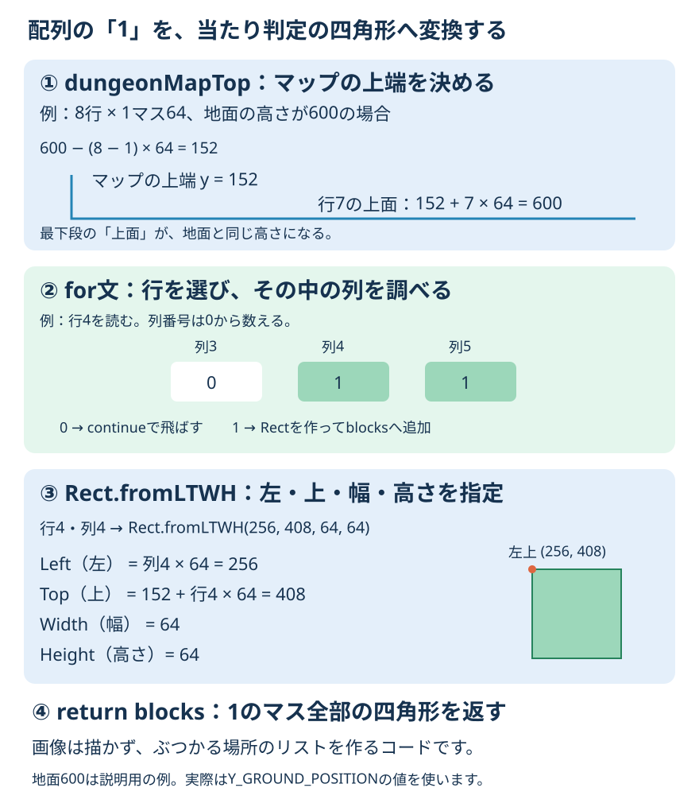
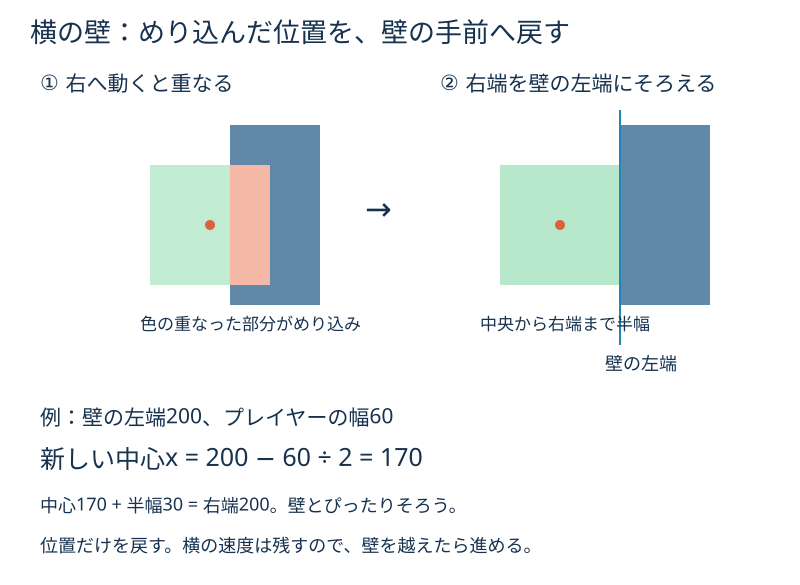
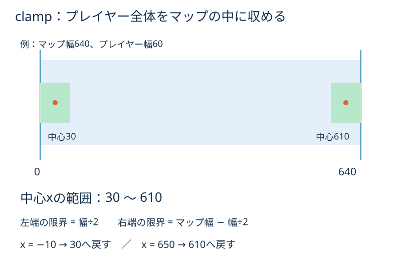
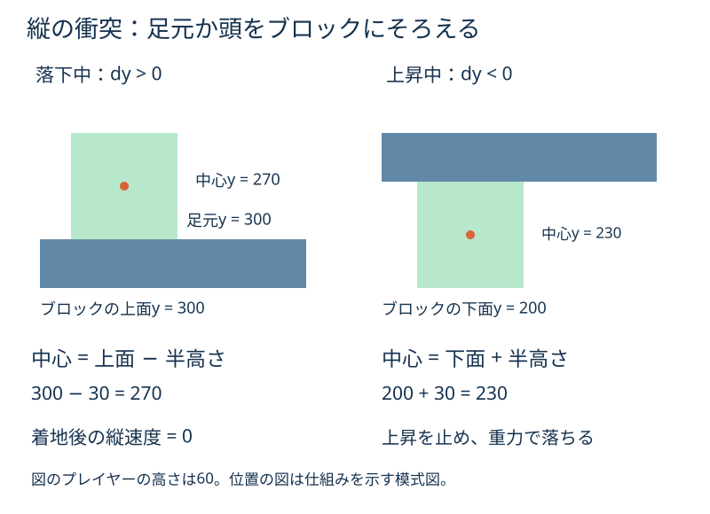
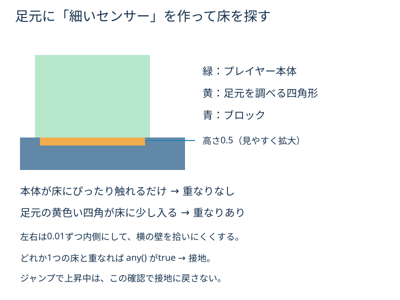
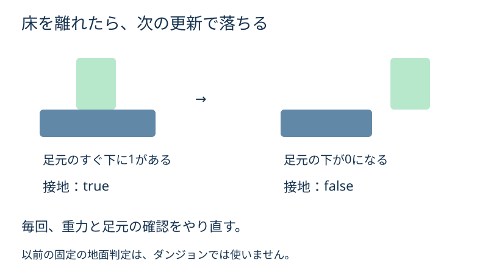
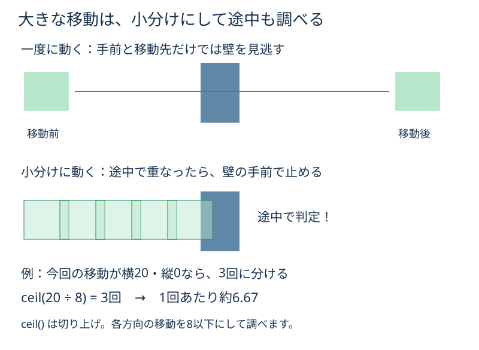

# **14_ブロックにぶつかる・上に乗る**

## **この単元でやること**

1. 配列の1を、当たり判定用の四角形にする
2. 横からぶつかったら止まり、上から落ちたら着地する
3. 下からぶつかったら上昇を止め、足場の端からは落下する

第13回で表示したブロックに、プレイヤーの当たり判定を付けます。今回も横から見る視点で、左右キーとジャンプを使います。上下のカメラ追従は次回です。

**新方針の第13回までのコードを使ってください。** 旧14のマス中央への配置や、重力を止める処理は使いません。開始位置は最下段の行7・列0の上にある第11回の位置を使います。開始場所へブロックを追加して、プレイヤーを埋めないようにしてください。

## **1. 今回の当たり判定の方針**

画像の透明部分ではなく、プレイヤー全体を四角形として扱います。プレイヤーは現在60×60、ブロックは64×64です。



今回は配列から作る四角形と、プレイヤーの四角形が重なるかを直接調べます。**ダンジョンのブロックに `RectangleHitbox` を追加する必要はありません。** 既存の `step` に対する `onCollision()` は、通常ステージ用として残します。

横方向と縦方向を順番に動かしてから、ぶつかった側の端をそろえます。



## **2. 描画と判定で同じブロック位置を使う**

**【dungeon.dart】配列の後、`DungeonMapComponent` の前に追加**

```dart
// 描画と当たり判定で同じマップ原点を使う
double get dungeonMapTop =>
    Y_GROUND_POSITION - (dungeonMap.length - 1) * dungeonTileSize;

// 値が1のマスを、ゲーム世界の四角形に変換する
List<Rect> createDungeonBlockRects() {
  final blocks = <Rect>[];
  for (int row = 0; row < dungeonMap.length; row++) {
    for (int column = 0; column < dungeonMap[row].length; column++) {
      if (dungeonMap[row][column] != dungeonBlock) continue;
      blocks.add(Rect.fromLTWH(
        column * dungeonTileSize,
        dungeonMapTop + row * dungeonTileSize,
        dungeonTileSize,
        dungeonTileSize,
      ));
    }
  }
  return blocks;
}
```



`Rect` は四角形です。`Rect.fromLTWH()` の引数は、左・上・幅・高さの順です。`createDungeonBlockRects()` は値が1のマスだけをリストにして返します。

`double get dungeonMapTop` は、参照されたときにマップ上端の高さを計算する書き方です。画面の高さに由来する地面位置が決まった後に計算できます。

**【dungeon.dart】`DungeonMapComponent.onLoad()` の `position` を変更**

```dart
position = Vector2(0, dungeonMapTop);
```

第13回の長い計算式を、この共通の値に置き換えます。描画と当たり判定で同じ原点を使い、見た目とぶつかる場所をそろえます。第13回のimportと画像の追加処理はそのままです。

## **3. プレイヤーにダンジョン専用の移動処理を追加する**

**【player.dart】importに追加**

```dart
import 'dungeon.dart';
```

**【player.dart】`Player` クラス内、`applyGravity()` の前に追加**

```dart
// Anchor.center のプレイヤーを四角形として表す
Rect get dungeonPlayerRect => Rect.fromCenter(
      center: Offset(position.x, position.y),
      width: size.x,
      height: size.y,
    );

void updateDungeonPhysics(double dt) {
  if (dt <= 0) return;
  if (isGameOver || isGoal) {
    velocity.setZero();
    stopMovement();
    return;
  }

  previousY = position.y;
  final blocks = createDungeonBlockRects();

  // 長い停止後に一気に進むのを防ぐ。上限は0.05秒
  final frameDt = dt > 0.05 ? 0.05 : dt;

  // 毎回重力を加え、床があるかを判定し直す
  velocity.y += gravity * frameDt;

  final moveX = velocity.x * frameDt;
  final moveY = velocity.y * frameDt;
  final longest = moveX.abs() > moveY.abs() ? moveX.abs() : moveY.abs();
  final steps = (longest / 8).ceil();
  final count = steps < 1 ? 1 : steps;
  final stepDt = frameDt / count;

  // 1回の移動を8以下に分け、薄い隙間の飛び越しを防ぐ
  for (int i = 0; i < count; i++) {
    final dx = velocity.x * stepDt;
    position.x += dx;

    for (final block in blocks) {
      if (!dungeonPlayerRect.overlaps(block)) continue;
      if (dx > 0) {
        position.x = block.left - size.x / 2;
      } else if (dx < 0) {
        position.x = block.right + size.x / 2;
      }
    }

    // 左右は、プレイヤー全体がマップ内に収まる範囲にする
    final mapWidth = dungeonMap[0].length * dungeonTileSize;
    position.x = position.x.clamp(
      size.x / 2,
      mapWidth - size.x / 2,
    ).toDouble();

    final dy = velocity.y * stepDt;
    position.y += dy;
    isOnGround = false;

    for (final block in blocks) {
      if (!dungeonPlayerRect.overlaps(block)) continue;
      if (dy > 0) {
        // 落下中：ブロックの上に足元をそろえる
        position.y = block.top - size.y / 2;
        velocity.y = 0;
      } else if (dy < 0) {
        // 上昇中：ブロックの下に頭をそろえる
        position.y = block.bottom + size.y / 2;
        velocity.y = 0;
      }
    }

    // 接触ぴったりでも「乗っている」を保つため、足元を確認
    if (velocity.y >= 0) {
      final feet = Rect.fromLTWH(
        position.x - size.x / 2 + 0.01,
        position.y + size.y / 2,
        size.x - 0.02,
        0.5,
      );
      isOnGround = blocks.any((block) => feet.overlaps(block));
    }
  }

  isFall = velocity.y > 0;
}
```

長い処理ですが、順番は「重力 → 横移動と壁 → 縦移動と着地 → 足元確認」です。次の説明と見比べてください。

### **横からぶつかったとき**

まず右へ動かし、壁と重なったら、**プレイヤーの右端が壁にそろう位置へ戻します。** `overlaps()` が調べるのは、この「四角形同士の重なり」です。



プレイヤーの位置は中央なので、壁の左端をそのまま設定しません。幅60なら半分の30を引きます。

```dart
position.x = block.left - size.x / 2;
```

左へ動いてぶつかった場合は逆です。壁の右端に半幅を足し、プレイヤーの左端をそろえます。

横の速度は残します。押し続けている間は毎回壁の手前へ戻り、ジャンプで壁の高さを越えれば、そのまま横へ進めます。

### **マップの左右端ではみ出さないようにする**

`clamp()` は指定した範囲に位置を収めます。中心だけでなく、**プレイヤー全体**をマップ内へ残すために、半幅ぶん内側を限界にします。



範囲内の値はそのまま、範囲外なら近い側の限界へ戻します。この教材では、全行の列数が同じで、マップ幅がプレイヤー幅より大きいことを前提にしています。

### **着地したとき・頭をぶつけたとき**

**落下中は足元、上昇中は頭を、ブロックの端へそろえます。** 画面のy座標は下へ増えるので、落下中は `dy > 0`、上昇中は `dy < 0` です。



| 動き | 中心の位置 | その後 |
| --- | --- | --- |
| 落下して着地 | `block.top - size.y / 2` | 縦速度を0にし、足元確認で接地にする |
| 上昇して頭をぶつける | `block.bottom + size.y / 2` | 縦速度を0にし、次の更新から重力で落ちる |

### **足元を毎回確認する理由**

**本体が床にぴったり触れているだけでは、重なりになりません。** そこで、足元のすぐ下に薄い四角形を作り、床を探します。



黄色い部分は実際に表示する画像ではなく、計算用の四角形です。高さは0.5マスではなく、ゲーム世界の距離で0.5です。図では見えるように拡大しています。

左右を0.01ずつ内側へ縮めて、真横の壁を床と取り違えにくくします。`any()` は、どれか1つのブロックと重なればtrueを返します。



足元を調べ直すことで、足場の端を離れたら `isOnGround` がfalseになります。trueのときは既存の `jump()` が使えますが、上昇中はこの確認で接地へ戻さないため、空中でジャンプを繰り返せません。

### **移動を小さく分ける理由**

**移動先だけを調べると、途中にある壁を飛び越してしまうことがあります。** 移動を小さく分け、途中も判定します。



例えば横へ20動くなら、`20 ÷ 8 = 2.5` を `ceil()` で切り上げて3回に分けます。1回あたり約6.67なので、8以下になります。縦も動く場合は、横と縦のうち大きい移動量を使って回数を決めます。

長い停止後には `dt` が大きくなるため、使う時間を最大0.05秒に制限します。例えば `dt = 0.2` でも、計算には0.05を使います。遅い更新では実時間より移動が遅くなる場合がありますが、この教材では大きな飛び越しを防ぐことを優先します。

## **4. ダンジョンだけ新しい移動処理へ進む**

**【player.dart】`update(double dt)` 内で、強化時間の更新の後・`previousY = position.y;` の前に追加**

```dart
if (currentStage == 2) {
  updateDungeonPhysics(dt);
  return;
}
```

元からある `super.update(dt)` と強化の残り時間の更新は残してください。通常ステージ用の `applyGravity()`、`checkGroundCollision()`、その後の位置更新も削除しません。

現在の通常ステージ用コードは、`applyGravity()` の中とその後の両方で位置を更新しています。ダンジョンでは上の `return` により、その処理を実行せず、新しい処理で1回分の移動だけを行います。通常ステージと歩く速さやジャンプの感触が違う場合があるため、確認はダンジョン内で行います。

**キー入力は変更不要です。** 左右移動・スペースのジャンプを使います。上下キーで移動する旧方式の処理は追加しません。

## **5. ダンジョンの古い地面表示を外す**

**【game.dart】`objectRemove()` 内の地面を追加する部分を置き換える**

```dart
if (currentStage != 2) {
  Cameraground ground = Cameraground();
  await world.add(ground);
}
```

ここからダンジョンの地面は最下段の1のブロックが担当します。古い地面表示と、プレイヤーの固定高さの地面判定はダンジョンでは使いません。

今回のマップは最下段をすべて1にしてください。穴へ落ちた後の復帰はまだ作っていないため、最下段へ0を追加する練習は後の回にします。左右端は前述の範囲制限で止まります。上方向には見えない壁を設けません。

`case 2` の `await world.add(DungeonMapComponent());` と入口の配置は第13回のままです。カメラもまだ左右追従のままです。

## **確認すること**

アプリを再起動し、扉からダンジョンへ入り直して確認します。

- 最下段のブロック上で立ち続けられる。
- 低い足場へ横から歩くと、その手前で止まる。
- ジャンプで足場を越え、上面へ着地できる。
- 足場の上で再度ジャンプできる。
- 足場の端から歩いて離れると下へ落ちる。
- ブロックの下からジャンプすると、頭をぶつけて落ちる。
- 左右のマップ端から外へ出ない。
- 通常ステージの左右移動・ジャンプが以前のまま使える。

第12回の足場の高さや間隔が難しい場合は、空中の1を横へ増やして着地面を広げてください。1段を64高くするなど、小さい差から試します。高い場所が画面外になる問題は次回の上下カメラで扱います。

## **練習と確認問題**

1. 右へ進んで壁にぶつかったら、どの端をそろえますか？
2. ブロック上に立っている状態を毎回調べ直すのはなぜですか？
3. ダンジョンの更新後に `return` するのはなぜですか？

<details>
<summary>答えと解説</summary>

1. プレイヤーの右端と、ブロックの左端をそろえます。
2. 足場の端を離れたら、接地を解除して落下する必要があるからです。
3. 通常ステージ用の重力・固定の地面判定・移動を重ねて実行しないためです。

</details>

## **今日の課題**

低い足場で「横から止まる」「上に乗る」「端から落ちる」を確認し、それぞれどの判定が働いたかメモしましょう。配列を変更するときも、最下段の地面と開始位置の空間は残してください。

## **次回への案内**

次は**上下にも追従するカメラ**です。高いブロックへジャンプして上ったプレイヤーを、画面が追いかけるようにします。

**今回はここで終了です。** 実装した場合の退避対象は `dungeon.dart`・`player.dart`・`game.dart` です。実行用の名前を残し、コピーを別名で保存してください。旧15の四方向移動の教材は使いません。
