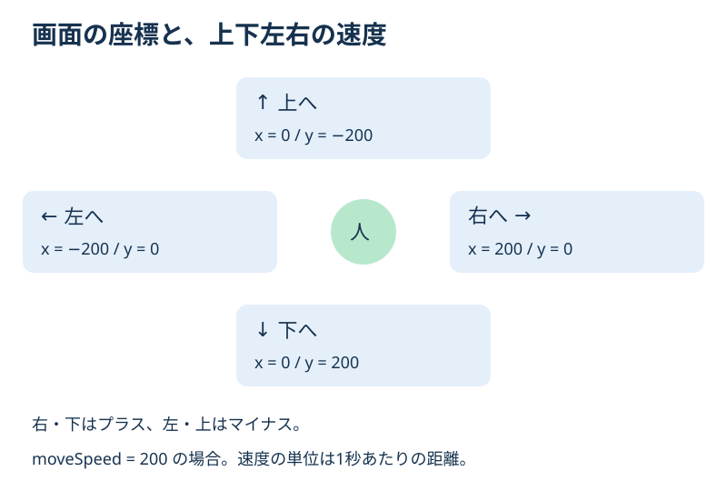
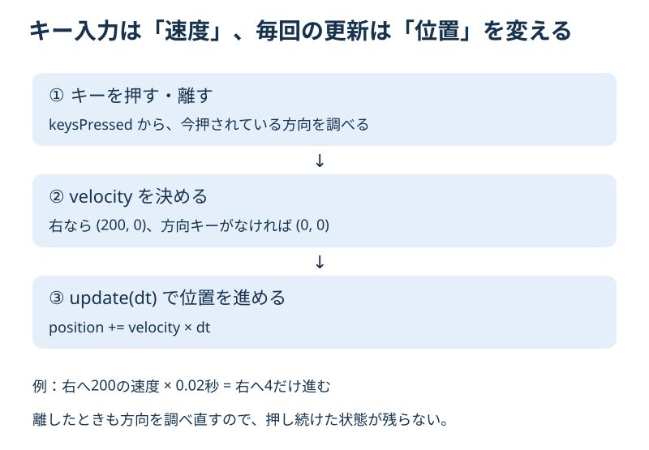

# **15_ダンジョンで上下左右に移動する**

## **この単元でやること**

1. 矢印キーから移動方向を決める
2. 重力なしで上下左右に移動する
3. キーを離したら止まる

前回は開始マスにプレイヤーを置きました。今回は矢印キーを押している間、連続して歩く方式にします。1マスずつ瞬間移動する方式ではありません。ブロックは64×64、プレイヤーは現在の60×60を使います。

**今回変更するのは `lib/player.dart` だけです。** 壁とマップ外への移動を止める処理は第16回で追加します。この回では壁を通り抜ける状態が正常です。

## **1. 方向を速度で表す**

`velocity` は、1秒間にどちらへどれだけ進むかを表します。xは横方向、yは縦方向です。画面では下へ進むとyが増えるため、上へ進む速度はマイナスになります。



既存の `moveSpeed = 200` を使います。これは1秒に200進む速度です。キーを離して止まるときは、xとyの両方を0にします。

## **2. ダンジョン用のキー入力処理を作る**

**【player.dart】`Player` クラス内の `moveLeft()` の直前に追加**

```dart
  //⭐️ 上下左右のうち、1方向だけに移動する
  void updateDungeonInput(Set<LogicalKeyboardKey> keysPressed) {
    velocity.setZero();

    if (isGameOver || isGoal) {
      stopMovement();
      return;
    }

    if (keysPressed.contains(LogicalKeyboardKey.arrowLeft)) {
      leftflg = true;
      rightflg = false;
      moveLeft();
    } else if (keysPressed.contains(LogicalKeyboardKey.arrowRight)) {
      leftflg = false;
      rightflg = true;
      moveRight();
    } else if (keysPressed.contains(LogicalKeyboardKey.arrowUp)) {
      velocity.y = -moveSpeed;
      animation = leftflg ? leftAnimation : rightAnimation;
    } else if (keysPressed.contains(LogicalKeyboardKey.arrowDown)) {
      velocity.y = moveSpeed;
      animation = leftflg ? leftAnimation : rightAnimation;
    } else {
      stopMovement();
    }
  }


```

`keysPressed` は、その時点で押されているキーの集まりです。`contains()` で指定したキーが含まれるかを調べます。

最初に `velocity.setZero()` で前の速度を消し、現在のキーから設定し直します。右から上へ切り替えたときに、右向きの速度を残さないためです。

`if` と `else if` でつなぐので、一度に選ぶ方向は1つです。同時に押した場合は左→右→上→下の順で優先されます。例えば右と上なら右に動き、右を離して上が残れば上に動きます。斜め移動はこの回では扱いません。

左右移動は既存の `moveLeft()` と `moveRight()` を使います。上下移動はyの速度を直接設定します。上下向きの画像はまだ用意していないため、画像は最後に向いた左右の向きのままです。

`stopMovement()` は既存の停止用アニメーションへの切り替えです。この関数だけではyの速度を消さないため、先頭で両方向の速度を0にすることが大切です。

## **3. キーを押したときも離したときも呼ぶ**

**【player.dart】`onKeyEvent()` の先頭にある、第14回の分岐を置き換える**

```dart
    //⭐️ ダンジョンでは、現在押されているキーから方向を決める
    if (currentStage == 2) {
      updateDungeonInput(keysPressed);
      return true;
    }
```

後ろにある横スクロール用のキー処理は残してください。この分岐は `if (event is KeyDownEvent)` より前に置きます。押したときだけでなく、離したときにも呼ぶ必要があるからです。

方向キーをすべて離すと `keysPressed` に方向キーがなくなり、速度が0になります。ダンジョンではここで返るため、スペースのジャンプやEの射撃、Qのアイテム使用は引き続き実行しません。



## **4. updateで位置を進める**

**【player.dart】`update(double dt)` 内の、第14回のダンジョン分岐を置き換える**

```dart
    //⭐️ ダンジョンは重力なしで、速度の方向へ移動する
    if (currentStage == 2) {
      if (isGameOver || isGoal) {
        velocity.setZero();
        stopMovement();
      }
      position += velocity * dt;
      isOnGround = false;
      isFall = false;
      return;
    }
```

場所は強化の残り時間を更新した後、`previousY = position.y;` の前です。既存の `super.update(dt)` や、その後の横スクロール用の処理は残します。

`dt` は前回の更新から経過した秒数です。速度にこの時間を掛けて、その更新で進む距離を求めます。例えば右向きの速度200、`dt` が0.02なら、右へ4進みます。

毎回固定の距離を足すと、更新回数が多い端末ほど速く動いてしまいます。時間を掛けることで、経過時間に応じた移動になります。

第14回の `velocity.setZero()` は、この分岐で毎回実行していました。今回はそのままでは動けないので、通常はキー入力側で速度を決めます。ゲームオーバー・ゴール中だけは更新側でも速度を0にし、止めます。

最後の `return` は残します。これにより横スクロール用の重力や地面判定は実行せず、位置の更新を二重に行うことも防ぎます。カメラは第13回の固定状態を使います。

## **確認すること**

アプリを再起動し、ステージ1の扉からダンジョンへ入って確認します。

- 開始マスに配置され、勝手に落下しない。
- 左右キーで横に、上下キーで縦に動く。
- 方向キーをすべて離すと、その場で止まる。
- 右と上を同時に押すと右に動き、右だけ離すと上へ動く。
- 斜めには動かない。スペースでジャンプしない。
- ダンジョンへ入る前の左右移動・ジャンプは従来どおり使える。

この回では壁やマップの外へも進めます。画面外へ移動して見失ったら、アプリを再起動して入り直してください。出口の緑のマスも、まだ場面の切り替えは行いません。

## **練習と確認問題**

1. 上へ動かすとき、なぜ `velocity.y` をマイナスにしますか？
2. `updateDungeonInput()` の最初で速度を0にするのはなぜですか？
3. 速度200で0.05秒進むと、移動距離はいくつですか？

<details>
<summary>答えと解説</summary>

1. 画面のy座標は下ほど大きくなるため、上へ進むには減らす必要があるからです。
2. 前の方向の速度を残さず、今押されているキーだけで方向を決め直すためです。
3. 200×0.05＝10です。速度に経過時間を掛けます。

</details>

## **今日の課題**

右→上→左→下の順に、短くキーを押して移動してみましょう。各方向でキーを離して止まることを確認します。2つの方向キーを同時に押したときも試し、どの方向が優先されたかをメモしてください。

## **次回への案内**

次は **16「壁との当たり判定を作る」** です。移動先のマスを調べ、壁やマップの外へ進めないようにします。

**今回はここで終了です。** 退避対象は `lib/player.dart` です。実行用ファイルは残し、コピーを別名で保存してください。図解は `img/15_directions.svg` と `img/15_input_update.svg` です。
