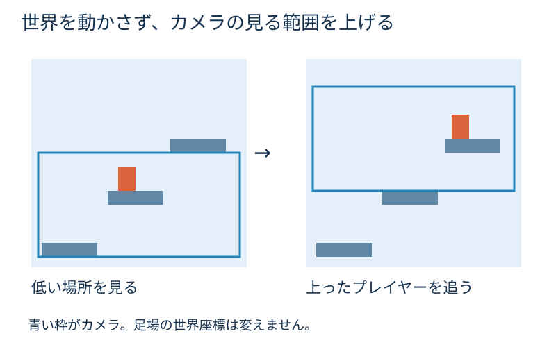
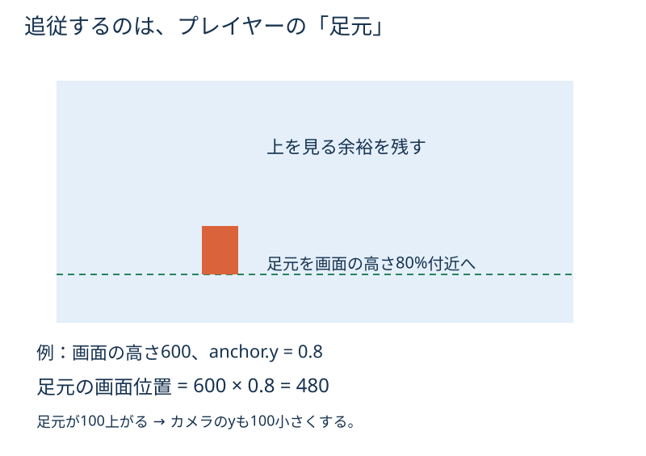
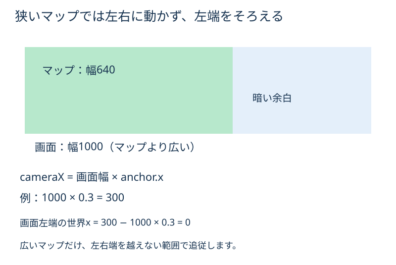
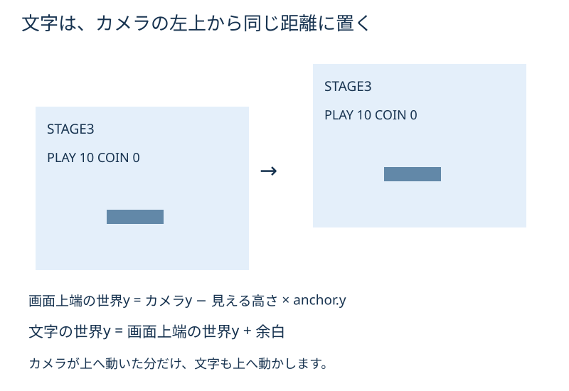

# **15_カメラを上下にも追従させる**

## **この単元でやること**

1. 高い足場へ上ったプレイヤーを、カメラが上下に追う
2. マップの幅に合わせて左右の追従範囲を決める
3. 背景と文字表示を、カメラが動いても見やすくする

第14回で、ブロックに乗れるようになりました。今回はプレイヤーがジャンプで高い場所へ進んだときに、画面も上へ動くようにします。落下したときは下へ追います。

**新方針の第14回までを実装したコードが前提です。** 旧15の上下左右へ歩く処理は使いません。左右キー・ジャンプ・重力・ブロック判定は今のままです。今回変更するのは `game.dart` です。

## **1. カメラは「世界のどこを見るか」を決める**



ブロックやプレイヤーは `world` にあります。その位置をまとめて動かすのではなく、`cameraComponent.viewfinder.position` を変えて、見る範囲を移します。ブロックの描画と当たり判定には引き続き世界の座標を使います。

## **2. プレイヤーの足元を追う**

現在の設定は `CAMERA_POSITION_X = 0.3`、`CAMERA_POSITION_Y = 0.8` です。カメラが見る基準位置を、画面の左から30%、上から80%に置く設定です。今回もこれを使います。



プレイヤーは `Anchor.center` なので、足元のy座標は `player.position.y + player.size.y / 2` です。地面に立っているとき、この値は `Y_GROUND_POSITION` になります。

中心を追うと、今まで地面に合わせていた画面が半身ぶんずれるため、ここでは足元を追います。端で追従を制限している間は、足元は80%の位置から離れることがあります。

## **3. ダンジョン用のカメラ処理を追加する**

**【game.dart】`MainGame` クラス内、`CameraRemove()` の後に追加**

```dart
void updateDungeonCamera() {
  final view = cameraComponent.viewfinder;
  final visibleSize = cameraComponent.viewport.virtualSize / view.zoom;
  final mapWidth = dungeonMap[0].length * dungeonTileSize;
  final anchorX = view.anchor.x;

  // マップが画面より狭い場合は、世界の左端0を画面左端に置く
  double cameraX;
  if (mapWidth <= visibleSize.x) {
    cameraX = visibleSize.x * anchorX;
  } else {
    cameraX = player.position.x.clamp(
      visibleSize.x * anchorX,
      mapWidth - visibleSize.x * (1 - anchorX),
    ).toDouble();
  }

  // 足元を追う。下側は地面、上側はマップの上に2マス余裕を取る
  final playerFeet = player.position.y + player.size.y / 2;
  final cameraTopLimit = dungeonMapTop - dungeonTileSize * 2;
  final cameraY = playerFeet.clamp(
    cameraTopLimit,
    Y_GROUND_POSITION,
  ).toDouble();

  view.position = Vector2(cameraX, cameraY);
}
```

`viewport.virtualSize` は、固定解像度カメラが使う論理的な画面サイズです。外側のウィンドウの物理的な大きさとは区別します。さらに `zoom` で割ると、世界の中で見える幅と高さになります。今回は `zoom = 1.0` を使います。

### **マップが画面より狭い場合**

第12回のマップは横10列×64＝640です。画面の幅が1000なら、すべての列が画面内に収まります。この場合は横追従をせず、世界の左端0を画面の左端に合わせます。



これは拡大表示ではありません。横に余白が残っても正常です。画面より広いマップでは、`clamp()` で左右端を越えない位置へカメラを収めます。

狭いマップで広いマップ用の計算をすると、制限範囲の最小値が最大値より大きくなることがあります。そのため先に場合分けしています。

### **縦方向の制限**

下側では、カメラの基準位置を `Y_GROUND_POSITION` より下へ動かしません。上側は `dungeonMapTop - 64 × 2` までにして、マップ上端より2マス上へ余裕を取ります。

ここで制限するのは**カメラの基準位置**で、画面の上端ではありません。マップの外側が見えることは許し、暗い背景で埋めます。プレイヤーの移動を制限する処理でもありません。

今回の地形を大きく変えてカメラの制限範囲を越えて移動できるようにした場合は、この余裕も見直してください。

## **4. 上へ動いても背景を暗くする**

既存の `CameraBackScreen` は世界の `(0, 0)` から描かれています。カメラがさらに上を見ると、背景の四角形の外が見えることがあります。

**【game.dart】`MainGame` クラス内に追加**

```dart
@override
Color backgroundColor() {
  if (currentStage == 2) {
    return const Color(0xFF242433);
  }
  return super.backgroundColor();
}
```

`backgroundColor()` はゲーム画面全体の下地の色です。ダンジョンでは既存背景と同じ暗い色を返します。背景の部品の外が見えても、色が変わらなくなります。

`screen.dart` の背景の四角形は今回は残します。通常ステージでは `super.backgroundColor()` で元の下地色を使います。

## **5. ステージ名・スコア・時間を画面に残す**

今の文字は `world` に置かれ、既存処理では横方向だけ位置を補正しています。このまま上下にカメラを動かすと、文字が画面外へ流れます。



今回は既存の文字を移し替えず、カメラ移動後に位置を補正します。`viewport` に直接追加する方法もありますが、既存の作り直し・削除の仕組みを維持するため、この回では世界内の文字を使います。

**【game.dart】`MainGame` クラス内に追加**

```dart
void updateDungeonHud() {
  final view = cameraComponent.viewfinder;
  final visibleSize = cameraComponent.viewport.virtualSize / view.zoom;
  final screenLeft = view.position.x - visibleSize.x * view.anchor.x;
  final screenTop = view.position.y - visibleSize.y * view.anchor.y;

  // 既存の文字はworld内にあるため、カメラの移動分だけ位置を補正
  for (final child in world.children) {
    if (child is StageText) {
      child.position = Vector2(screenLeft + 16, screenTop + 12);
    } else if (child is ScoreText) {
      child.position = Vector2(screenLeft + 16, screenTop + 48);
    } else if (child is countTimer) {
      child.position = Vector2(screenLeft + 16, screenTop + 150);
    }
  }
}
```

`screenLeft` と `screenTop` は、画面の左上が世界のどこにあるかを表します。そこへ余白を足すことで、文字が画面上の同じ場所に見えます。

ステージ名・スコア・時間を縦に並べ、スコアの下に表示されるアイテム情報のスペースを取っています。今回は等倍なので、この余白をそのまま使えます。ズーム変更時も文字サイズまで固定する機能は、この回には含みません。

`StageText`・`ScoreText`・`countTimer` は実際のクラス名です。既存の文字の更新処理は削除せず、カメラ更新の後で位置だけを補正します。

## **6. 毎回の更新から呼ぶ**

**【game.dart】`MainGame.update(double dt)` 全体を置き換える**

`Player.update()` ではありません。`super.update(dt)` は先頭に残します。

```dart
@override
void update(double dt) {
  super.update(dt);

  if (currentStage == 2) {
    updateDungeonCamera();
    updateDungeonHud();
    return;
  }

  // 通常ステージの左右追従は、これまでどおり
  if (player.position.x > VIEW_X_START && player.position.x < VIEW_X_END) {
    cameraComponent.viewfinder.position = Vector2(
      player.position.x,
      Y_GROUND_POSITION,
    );
  } else if (player.position.x > VIEW_X_END) {
    cameraComponent.viewfinder.position = Vector2(
      VIEW_X_END,
      Y_GROUND_POSITION,
    );
  } else {
    cameraComponent.viewfinder.position = Vector2(
      VIEW_X_START,
      Y_GROUND_POSITION,
    );
  }
}
```

`super.update(dt)` でプレイヤーなどの部品を更新してから、その新しい位置へカメラを合わせます。さらに文字の位置を補正します。ダンジョンでは `return` して、従来の横追従処理にカメラのy座標を地面へ戻されないようにします。

**以前の末尾の `cameraComponent.update(dt);` は残しません。** カメラはゲームの部品として `super.update(dt)` で更新されるため、手動で重ねて更新する必要はありません。

### **CameraRemove()は共通設定を使う**

第14回から次の状態であれば、ここは変更不要です。古い `Anchor.topLeft` に固定する分岐が残っていないか確認します。

```dart
Future<void> CameraRemove() async {
  cameraComponent.viewfinder.anchor = Anchor(
    CAMERA_POSITION_X,
    CAMERA_POSITION_Y,
  );
  cameraComponent.viewfinder.position = Vector2.zero();
  cameraComponent.viewfinder.zoom = 1.0;
}
```

## **確認すること**

アプリを再起動し、扉から入り直します。

- 地面に立った時は、今までに近い高さで表示される。
- ジャンプ・足場への移動で、画面が上へ追従する。
- 足場から落ちると画面も下へ戻り、地面より下へ追い続けない。
- マップの上の空間や右側の余白も暗い色で表示される。
- ステージ名・スコア・時間が画面の上側に残る。
- 幅640のマップが画面内に収まる場合、横追従しなくても正常。
- 通常ステージの左右追従は従来どおり。

届きにくい足場は、行の差を1段（64）にしたり、横へ広げたりして試します。ジャンプ力や重力はこの回では変更しません。カメラの追従は即座に行い、なめらかな遅延追従は追加していません。

現時点の `Y_GROUND_POSITION` などは起動時の画面サイズに基づきます。ウィンドウを変更して位置が合わなくなった場合は再起動してください。実行中の画面サイズ変更へ完全対応する回ではありません。

## **練習と確認問題**

1. カメラが上へ動いたとき、ブロックの世界座標も変えますか？
2. プレイヤーの足元がy＝300なら、今回カメラの基準位置に使うyはいくつですか？（制限範囲内とする）
3. 幅640のマップを幅1000の画面で見る場合、横追従しないのはなぜですか？

<details>
<summary>答えと解説</summary>

1. 変えません。世界の中で見る範囲だけを変えます。
2. 300です。中心に半高さを足した足元の位置を追います。
3. マップ全体が横方向に収まるためです。左端をそろえ、余白を暗い色で表示します。

</details>

## **今日の課題**

低い足場から高い足場へ上り、足場の位置関係が変わらず画面だけが追いかけることを確認しましょう。スコアなどの文字が画面上に残る理由を、世界座標と画面の左上の関係で説明してみてください。

## **次回への案内**

今回はここで終了です。この先は、到達点や出口などダンジョンの遊びを追加する段階へ進めます。次回の内容は次の指示で決めます。

**実装した場合の退避対象は `game.dart` です。** 実行用のファイル名は残し、コピーを別名で保存してください。今回の図解4点は `img/15_side_*.svg` に保存します。
