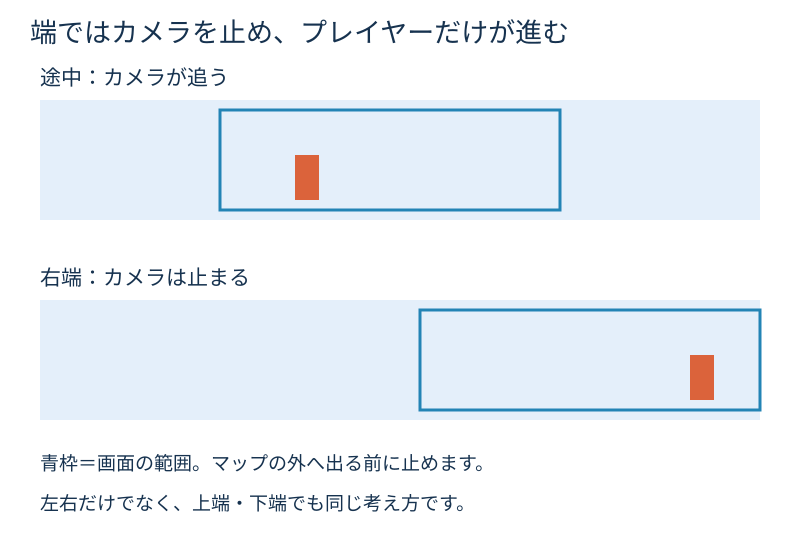
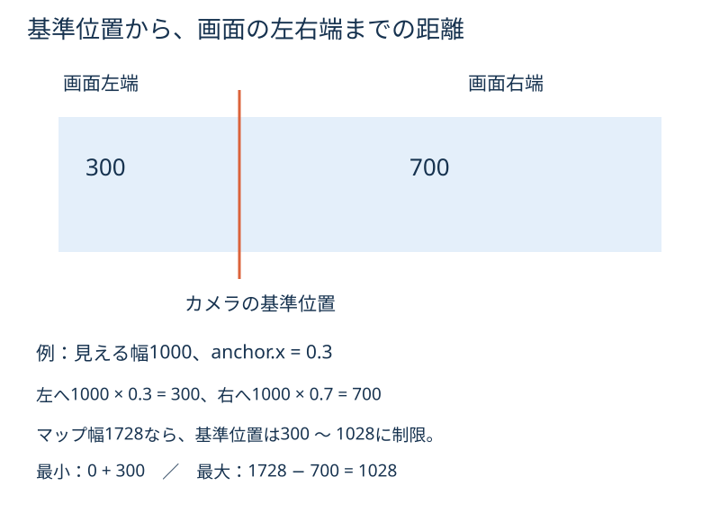
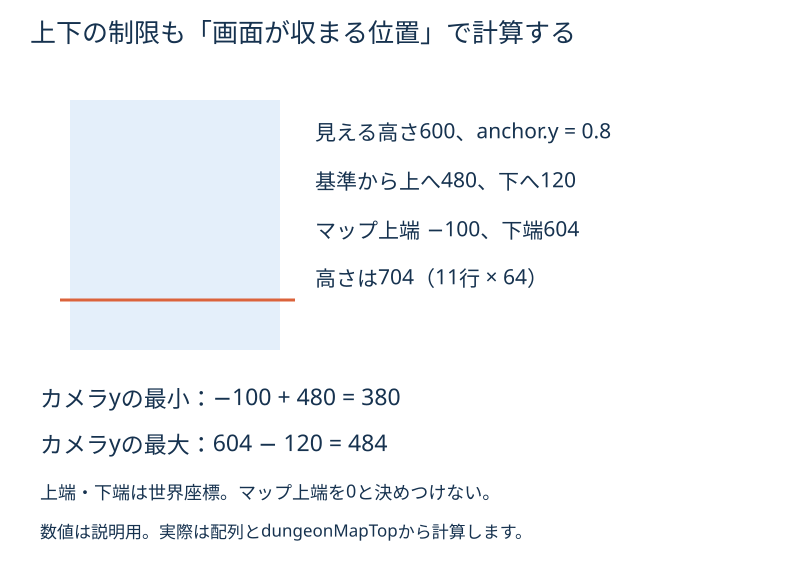
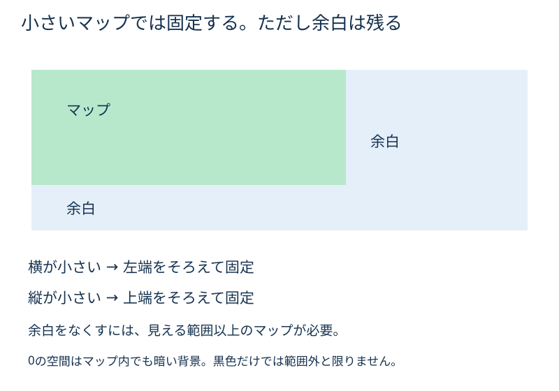

# **16_ダンジョンの端でカメラを止める**

## **この単元でやること**

1. 上下左右の端で、カメラの追従を止める
2. マップが画面より小さい方向はスクロールしない
3. カメラの範囲と、プレイヤーの移動範囲を区別する

第15回は上下追従を優先し、マップの外側も暗い背景として表示しました。今回はステージ1のように、端ではカメラが止まり、プレイヤーだけが画面内を動く形にします。

**新方針の第15回まで実装したコードが前提です。** 今回変更するのは `game.dart` のカメラ処理だけです。重力・ジャンプ・ブロック判定・文字の位置補正はそのまま使います。



## **1. 「カメラの位置」と「画面の端」は違う**

`viewfinder.position` は、カメラが見る基準位置です。画面の左上そのものではありません。どこを基準にするかは `anchor` で決まります。

今の設定はxが0.3、yが0.8です。横1000の範囲が見えているなら、基準位置から左へ300、右へ700が画面に入ります。



例えば幅1728のマップなら、カメラのx座標は300〜1028に収めます。左端では `300 − 300 = 0`、右端では `1028 + 700 = 1728` になり、画面の端がマップの端にそろいます。

第15回のy座標の制限は「足元を地面まで追う」方式でした。今回は**見える画面全体がマップの中へ収まる範囲**に変更します。

## **2. 上下も同じ式で求める**

縦方向は、マップの上端 `dungeonMapTop` を起点に考えます。上端は画面サイズなどによってマイナスになることもあります。



| 求める位置 | 計算 |
| --- | --- |
| カメラの最小位置 | マップ先頭 + 見える長さ × anchor |
| カメラの最大位置 | マップ先頭 + マップの長さ − 見える長さ × (1 − anchor) |

この計算は横にも縦にも使えます。横では「先頭」は左端、縦では上端です。

現在確認した配列は27列×11行で、1マス64なので1728×704です。教材ではこの数値を固定せず、毎回配列からサイズを求めます。配列を広げたときも、計算式を書き直す必要はありません。

## **3. 1方向分を制限する関数を追加する**

**【game.dart】`MainGame` クラス内、`updateDungeonCamera()` の前に追加**

```dart
// 1方向分のカメラ位置を、マップの範囲に収める
double limitDungeonCameraAxis({
  required double target,
  required double mapStart,
  required double mapLength,
  required double visibleLength,
  required double anchor,
}) {
  // マップが画面内に収まる場合は、先頭にそろえて固定する
  if (mapLength <= visibleLength) {
    return mapStart + visibleLength * anchor;
  }

  final minPosition = mapStart + visibleLength * anchor;
  final maxPosition =
      mapStart + mapLength - visibleLength * (1 - anchor);

  return target.clamp(minPosition, maxPosition).toDouble();
}
```

`required` は、呼び出すときに省略できない引数を表します。名前付きの引数なので、長さや位置をどの順で渡すかを混同しにくくなります。

| 引数 | 意味 |
| --- | --- |
| `target` | 追いかけたい位置。横はプレイヤーの中心、縦は足元 |
| `mapStart` | マップの左端または上端 |
| `mapLength` | マップ全体の幅または高さ |
| `visibleLength` | カメラに見えている世界の幅または高さ |
| `anchor` | 基準位置の割合。横0.3、縦0.8 |

`clamp()` で範囲内ならそのまま、範囲外なら端へ戻します。プレイヤーの位置は変更せず、カメラの位置だけを返します。

### **小さいマップを先に場合分けする理由**

マップが画面より小さい場合、画面全体をマップ内に収めることはできません。先に場合分けしないと、最小位置が最大位置より大きくなることがあります。



この教材では、横は左端、縦は上端にそろえて固定します。両方小さければ上下左右ともスクロールしません。片方だけ小さければ、その方向だけ固定します。

固定は拡大表示ではありません。余白は第15回の暗い下地色で残ります。余白までなくしたい場合は、マップを見える幅・高さ以上へ広げる必要があります。

## **4. updateDungeonCameraを置き換える**

**【game.dart】第15回の `updateDungeonCamera()` 全体を置き換える**

```dart
void updateDungeonCamera() {
  final view = cameraComponent.viewfinder;
  final visibleSize = cameraComponent.viewport.virtualSize / view.zoom;
  final mapWidth = dungeonMap[0].length * dungeonTileSize;
  final mapHeight = dungeonMap.length * dungeonTileSize;
  final playerFeet = player.position.y + player.size.y / 2;

  final cameraX = limitDungeonCameraAxis(
    target: player.position.x,
    mapStart: 0,
    mapLength: mapWidth,
    visibleLength: visibleSize.x,
    anchor: view.anchor.x,
  );

  final cameraY = limitDungeonCameraAxis(
    target: playerFeet,
    mapStart: dungeonMapTop,
    mapLength: mapHeight,
    visibleLength: visibleSize.y,
    anchor: view.anchor.y,
  );

  view.position = Vector2(cameraX, cameraY);
}
```

横と縦で同じ関数を1回ずつ呼びます。横のマップ先頭は0、縦は `dungeonMapTop` です。

`virtualSize / zoom` は、世界の中で見える範囲です。今回は第15回と同じ等倍（zoom＝1）で確認してください。画像のピクセル数やブラウザ外枠の大きさを直接使うわけではありません。

第15回の `cameraTopLimit` と、`Y_GROUND_POSITION` を上限にする縦の `clamp()` は、古い関数と一緒に置き換わります。新旧の縦追従を両方残さないでください。

## **5. 毎回の呼び出し順はそのまま使う**

**【game.dart】`MainGame.update()` の確認のみ**

```dart
super.update(dt);

if (currentStage == 2) {
  updateDungeonCamera();
  updateDungeonHud();
  return;
}
```

この後の通常ステージの左右追従も残します。カメラ位置を先に確定し、その位置に合わせて文字を補正します。`updateDungeonHud()`、`backgroundColor()`、`CameraRemove()` は変更不要です。

`cameraComponent.update(dt)` を手動で追加する必要はありません。

## **6. 今回の正常な見え方**

### **端ではプレイヤーが画面内を移動する**

マップの途中では、プレイヤーは基準位置付近に見えます。カメラが端へ着くとそれ以上は動かず、プレイヤーが画面の端へ近づきます。常に画面の同じ場所へプレイヤーを固定する仕組みではありません。

### **地面の画面内の高さが変わることがある**

最下段のブロックの下辺もマップ内に含めます。画面の下端がその下辺にそろう場合、ブロックの上面は画面下端から64上に見えます。第15回の「足元を高さ80%に置く」見え方と違っても正常です。

### **暗い部分が必ず範囲外とは限らない**

配列の0も暗い背景なので、マップ内に暗い空間は残ります。今回なくすのは、マップが十分大きい方向で、カメラが追いすぎて外側を映すことです。小さいマップの余白まで消す処理ではありません。

### **カメラはプレイヤーの移動を止めない**

プレイヤーの左右制限や着地は第14回の担当です。マップ上端を越えてジャンプできる配置では、カメラが上端で止まった後、プレイヤーが画面上へ見切れる場合があります。最上段付近の遊び場には空間の行を足すなど、頭上の余裕を用意してください。天井や落下復帰は別の地形・ゲーム処理です。

## **確認すること**

再起動してダンジョンへ入り直し、確認します。

- 途中では左右・上下に追従する。
- 右端・左端では、画面の外側を映す前にカメラが止まる。
- 高い足場やジャンプで上へ進むと、上端でカメラが止まる。
- 下へ降りると、マップ下端でカメラが止まる。
- カメラが止まってもプレイヤーは動ける。
- ステージ名・スコア・時間が画面上に残る。
- 小さい方向は固定され、余白が残る。
- 通常ステージのカメラは以前どおり。

現在のマップ高さ704に対し、見える高さが704以上なら縦追従は止まります。これは不具合ではありません。上下端を試すには、それより縦に大きいマップを使うか、起動時のゲーム画面を小さくして再起動してください。実行中の画面サイズ変更への完全対応はこの回には含めません。

## **練習と確認問題**

1. カメラの基準位置をマップ右端まで動かすと、なぜ外側が見えますか？
2. 高さ704のマップに、見える高さ800の画面を収められますか？
3. 横1000が見え、anchor.xが0.3の場合、基準から画面右端まではいくつですか？

<details>
<summary>答えと解説</summary>

1. 基準位置より右にも画面が広がっているためです。その分だけ手前で止めます。
2. 収められません。この回では上端へそろえて固定し、下側に余白を残します。
3. 1000×(1−0.3)＝700です。

</details>

## **今日の課題**

マップの途中と端で、プレイヤーの画面内の位置がどう変わるか比べてください。「カメラが止まる」と「プレイヤーが止まる」の違いを短くメモしましょう。

## **次回への案内**

今回はここで終了です。この先は出口・到達点などを追加する段階です。次回の内容は次の指示で決めます。

**実装した場合の退避対象は `game.dart` です。** 実行用のファイル名を残し、コピーを別名で保存してください。図解は `img/16_*.svg` を使います。
