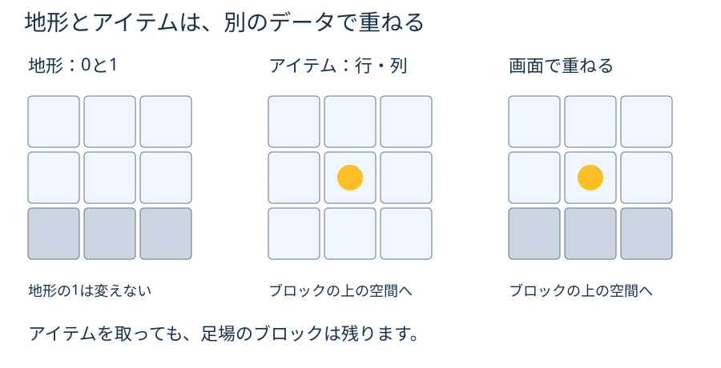
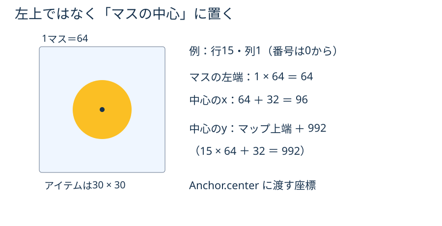
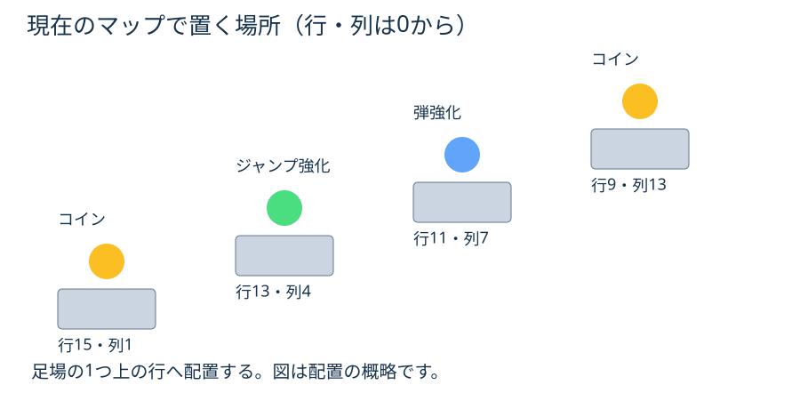
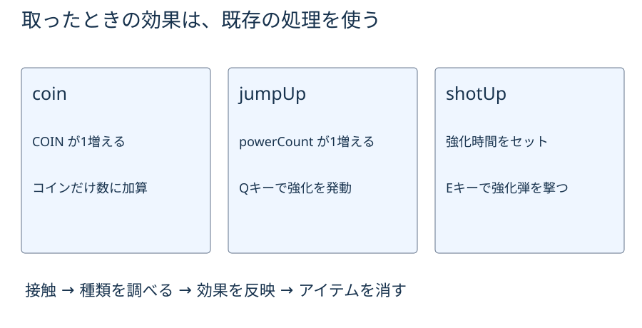

# **17_ダンジョンにアイテムを置く**

## **この単元でやること**

1. 地形とは別のリストに、アイテムの種類と置き場所を書く
2. 行・列から世界座標を計算し、足場の上へ置く
3. 既存の取得処理でコイン・ジャンプ強化・弾強化を使う

**第16回までの横から見るダンジョンが前提です。** 今回実装するファイルは `dungeon.dart` と `game.dart` です。新しい画像は不要で、既存の `coin.png`・`power.png`・`power2.png` を使います。

教材作成時のマップは **18行×27列、1マス64** です。第16回本文の11行の例より縦に拡張されています。自分の配列が違う場合は、以下の行・列を自分の足場に合わせてください。配列全体を置き換える必要はありません。

## **1. 地形とアイテムを分けて考える**

`dungeonMap` はこれまでどおり、0＝空間、1＝ブロックです。今回は2や3を追加せず、別の `dungeonItemList` に置き場所を書きます。



足場は1、アイテムを置くマスはその上の0です。同じ場所にブロックとアイテムを置くと、アイテムが壁に埋まって取りにくくなります。

アイテムはその場所に浮いたままです。プレイヤーのように重力で落ちたり、床を探して着地したりはしません。

## **2. 既存のアイテムを確認する**

**【setting.dart】確認のみ。変更しません。**

現在の `coinlist` は次の並びです。`templateIndex` には、このリストの番号を入れます。

| リスト番号 | 画像 | 種類 | 取得したとき |
| --- | --- | --- | --- |
| 0 | coin.png | ItemType.coin | コイン数が1増える |
| 1 | coin.png | ItemType.coin | 同じコイン。今回は0を使う |
| 2 | power.png | ItemType.jumpUp | ジャンプ強化の所持数が1増える |
| 3 | power2.png | ItemType.shotUp | 弾強化の残り時間を設定する |

ここでの番号は、地形の0・1とは別の意味です。リストの順番を変更すると、参照するアイテムも変わります。

新しい仕組みを最初から作るのではなく、既存の画像・サイズ・効果を借りて、ダンジョン用の座標だけ作り直します。通常ステージの `coinlist` の座標は書き換えません。

## **3. アイテムの配置データと変換関数を追加する**

**【dungeon.dart】ファイルの一番下、`DungeonMapComponent` クラスを閉じる最後の `}` の後に、次を追加します。クラスの中ではありません。**

既存の `import 'setting.dart';` があれば、importの追加は不要です。

```dart
// 地形とは別に、アイテムの種類と置き場所を管理する
class DungeonItemData {
  final int templateIndex;
  final int row;
  final int column;

  const DungeonItemData({
    required this.templateIndex,
    required this.row,
    required this.column,
  });
}

const List<DungeonItemData> dungeonItemList = [
  DungeonItemData(templateIndex: 0, row: 15, column: 1),
  DungeonItemData(templateIndex: 2, row: 13, column: 4),
  DungeonItemData(templateIndex: 3, row: 11, column: 7),
  DungeonItemData(templateIndex: 0, row: 9, column: 13),
];

// 行・列を、既存のcoinが受け取れる世界座標へ変換する
List<CoinData> createDungeonItems() {
  final items = <CoinData>[];

  for (final item in dungeonItemList) {
    final template = coinlist[item.templateIndex];

    items.add(CoinData(
      idx: items.length,
      size_x: template.size_x,
      size_y: template.size_y,
      pos_x: (item.column + 0.5) * dungeonTileSize,
      pos_y: dungeonMapTop + (item.row + 0.5) * dungeonTileSize,
      coin_img: template.coin_img,
      type: template.type,
    ));
  }

  return items;
}
```

`DungeonItemData` は「種類の参照番号・行・列」をひとまとめにするクラスです。`const` の配置リストは、起動後に書き換えない設計図として使います。

`createDungeonItems()` は、その設計図を既存の `coin` クラスが受け取れる `CoinData` のリストへ変換します。

- `template` から画像・幅・高さ・効果をコピーする。
- `pos_x`・`pos_y` はダンジョンの行・列から新しく計算する。
- `idx` は作成中のリストの件数を使い、0、1、2、3と付ける。種類を選ぶ番号ではない。
- 関数を呼ぶたびに新しく作るため、その時点の `dungeonMapTop` を使える。

### **なぜ0.5を足すの？**

`coin` は `Anchor.center` なので、渡す位置はアイテムの中心です。列×64だけではマスの左端になるため、半マスの32を足します。



行15・列1なら、次の計算になります。

```dart
x = (1 + 0.5) * 64;                 // 96
y = dungeonMapTop + (15 + 0.5) * 64; // マップ上端 + 992
```

yには、画面の上端ではなく、描画・当たり判定と共通の **`dungeonMapTop`** を足します。マップ上端がマイナスでも、この式のままで使えます。

アイテムは30×30、マスは64×64です。マス中央に置くと上下左右に17ずつ余白ができます。真下のマスがブロックなら、アイテムの下端と足場の上面の間が17空きます。

### **今回の配置を確かめる**



| アイテム | アイテムのマス（0） | 真下の足場（1） |
| --- | --- | --- |
| コイン | 行15・列1 | 行16・列1 |
| ジャンプ強化 | 行13・列4 | 行14・列4 |
| 弾強化 | 行11・列7 | 行12・列7 |
| コイン | 行9・列13 | 行10・列13 |

番号はすべて0から数えます。行15は上から16行目、列1は左から2列目です。

このコードは行列の範囲や壁との重なりを自動修正しません。配置はマップ内の0を選んでください。また、上側へ行を足した場合、固定した行番号も見直します。

**ここで一度確認：** 保存してエラーがないことを確かめます。まだゲームへ追加していないため、この段階ではアイテムが見えなくても正常です。

## **4. ダンジョンを作るときにアイテムを追加する**

**【game.dart】`MainGame.objectRemove()` の `switch (currentStage)` にある `case 2:` から、その直後の `break;` までを置き換えます。case 0・case 1は残します。**

```dart
      case 2:
        await world.add(DungeonMapComponent());

        for (final data in createDungeonItems()) {
          final item = coin(data, 0, 0, 0)..priority = 2;
          await world.add(item);
        }
        break;
```

`for` で配置データを1件ずつ取り出し、アイテムを作ります。`..priority = 2` は、作ったアイテムに続けて描画順を設定する書き方です。現在のブロックは1、プレイヤーは10なので、その間に描かれます。

### **coin(data, 0, 0, 0) の0は何？**

**【object.dart】既存のコードの確認だけです。書き換えません。**

```dart
coin(this.data, this.count_x, this.count_y, this.gap);
```

後ろの3つは、通常ステージで同じコインを格子状に並べるための「横の番号・縦の番号・間隔」です。今回は配置先の座標をすでに計算してあるため、すべて0にして追加のずらしをなくします。

`coin` の `onLoad()` が `data.pos_x` と `data.pos_y` を読みます。作成直後に `position` だけを変更する方法では、`onLoad()` で位置を上書きされる場合があるため、今回はデータに座標を渡します。

### **worldへ追加する理由**

ブロックとアイテムを、同じ世界座標で配置するためです。カメラが上へ動いても、アイテムと足場の位置関係は変わりません。画面に固定する `cameraComponent.viewport` へは追加しません。

ここまで反映したら、ホットリスタートしてダンジョンへ入り直します。配置はステージを作るときに行うので、保存しただけでは現在のステージに追加されないことがあります。

## **5. 取得処理は既存のものを使う**

**【player.dart】`onCollisionStart()` の確認のみ。新しい取得処理を追加しません。**

既存の `coin` は `RectangleHitbox` を持っています。プレイヤーに触れると、既存の `if (other is coin)` 内の `switch (other.data.type)` が種類を調べます。



ジャンプ強化は、拾った瞬間にジャンプが高くなるわけではありません。所持数 `powerCount` を増やし、既存のQキー操作で1つ使います。弾強化は拾った時点で残り時間がセットされ、Eキーで撃つ弾が強化されます。

取得後は既存の `removeFromParent()` でアイテムが消えます。地形の配列は変更しないので、下の足場は残ります。

現在のコードには、アイテムを消すだけの `if (other is coin)` と、効果を適用して消す `if` の両方があります。今回それらを追加する必要はありません。取得処理をもう1つコピーすると、コインや所持数が二重加算される原因になります。

## **6. 今回の正常な見え方と注意点**

- 配置リストの4個が足場の上に浮いている。
- プレイヤーが触れると消え、それぞれの効果が適用される。
- カメラで見えなくなっても、未取得のアイテムは同じ場所に残る。
- 取得後に同じ場所へ戻っても、その場では復活しない。
- `objectRemove()` でステージを作り直すと、配置リストから再び生成される。取得状況の保存はまだ行わない。
- 配置リストの追加先はcase 2だけなので、通常ステージの配置は変わらない。

背景の黒とネイビーの境目は、アイテムや地形の配列の境界ではありません。前回確認した `screen.dart` の `CameraBackScreen` は別の背景四角形です。今回の作業で背景色や背景サイズは変更しません。

## **動作確認**

1. 再起動してダンジョンへ入り、最初の足場のコインを取る。COINが1だけ増えるか確認する。
2. その場所を行き来しても、もう一度増えないことを確かめる。
3. 次の足場のジャンプ強化を取り、Qキーを押してからジャンプする。
4. 弾強化を取ってEキーで撃ち、既存の強化弾になることを確かめる。
5. 上下に移動し、アイテムが足場と一緒にスクロールすることを確認する。
6. 通常ステージでも、以前のアイテムが取れることを確認する。

出てこない場合はcase 2への追加と入り直し、埋まる場合は行・列、画像が出ない場合は既存素材のファイル名を確認します。上のアイテムへ届かない場合は、まず到達できる足場の上へ移して取得を試してください。

## **練習と確認問題**

1. コインを置くために、`dungeonMap` の0を2に変える必要はありますか？
2. 列4に置くアイテムの中心のx座標はいくつですか？
3. ジャンプ強化を拾った後、どのキーで使用しますか？
4. 新しいコインを増やすとき、主にどのリストへ1行追加しますか？

<details>
<summary>答えと解説</summary>

1. 不要です。地形は0・1のままで、アイテムを別に管理します。
2. `(4 + 0.5) × 64 = 288` です。列の左端256へ半マス32を足します。
3. Qキーです。取得で所持数が増え、使用で1つ減ります。
4. `dungeonItemList` です。例えば現在のマップなら、次の行を追加すると行10・列10の空間へコインを置けます。真下の行11・列10は足場です。

```dart
DungeonItemData(templateIndex: 0, row: 10, column: 10),
```

</details>

## **今日の課題**

到達できる足場を1つ選び、その上へコインを1個追加してください。行・列をメモし、取得でCOINが1増えること、下の足場は消えないことを確認しましょう。

## **次回と退避するファイル**

第18回は **「ダンジョンに敵を置く」** です。今回のアイテム配置を土台に、敵の配置と動きを扱います。今回はここで終了です。

実装後の退避対象は **`dungeon.dart` と `game.dart`** です。実行用のファイル名を残し、コピーを別名で保存してください。教材の図は `img/17_*.svg` を使います。
